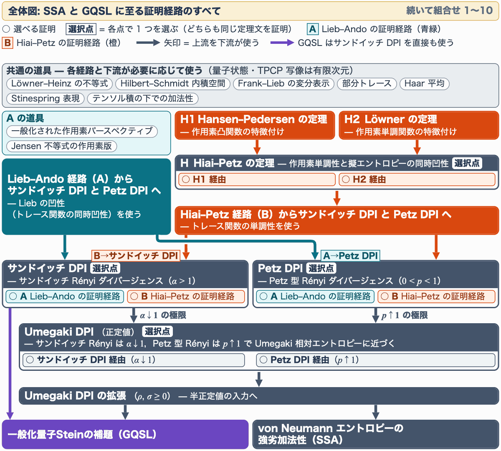
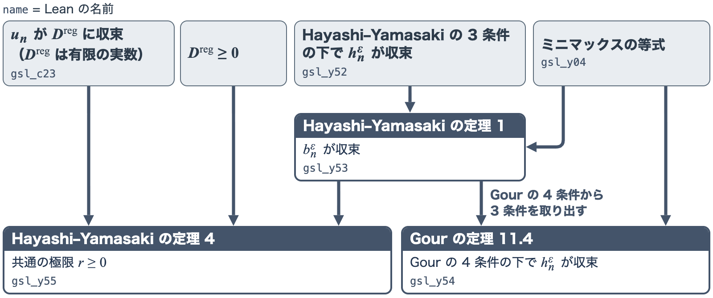

<p align="right"><a href="README.md"></a> </p>

# Lean-Quantum: 量子情報理論のAI援用 Lean 形式化<br><sub>Löwner と Hiai–Petz の定理から一般化量子Steinの補題へ</sub>

証明支援系 Lean で書いた量子情報理論のライブラリです．Löwner の定理と Hiai–&#8288;Petz の定理を形式化し，それらからサンドイッチ Rényi ダイバージェンス，Petz 型 Rényi ダイバージェンス，Umegaki 相対エントロピーの 3 つのデータ処理不等式（DPI．完全正・トレース保存（TPCP）写像 $\Phi$ について $D(\Phi\rho\Vert\Phi\sigma)\leq D(\rho\Vert\sigma)$ ）を証明しました．DPI には Lieb–&#8288;Ando トレース不等式による証明もあり，強劣加法性（SSA）と一般化量子Steinの補題はどちらの証明からでも導かれます．

このリポジトリは，投稿準備中の Lean-Quantum の第 2 の論文（Paper 2）で報告する形式化のコードです．

<!-- BEGIN BADGES -->
<p align="center">
<a href="https://lean-lang.org/"></a>
<a href="LICENSE"></a>
</p>
<!-- END BADGES -->

著者：笠浦一海，塚本慧，森健人，水野理沙，生田目敬大，折池雄太，谷口雅弥，園田翔，山崎隼汰．

DPI は複数の証明経路（同じ定理に至る証明の道筋）で証明しています．どの経路を使っても，SSA と GQSL のステートメントとその証明コードは変わりません．下のアニメーションは，最初に証明経路の全体を示し，続いて SSA と GQSL の証明で使われる証明の組合せ 10 通りを 1 つずつ示します．

<p align="center"></p>

## 目次

- [背景と形式化の範囲](#背景と形式化の範囲)
- [実行方法](#実行方法)
- [このコードで形式化した主要定理](#このコードで形式化した主要定理)
- [Comparator による検査](#comparator-による検査)
- [先行研究](#先行研究)
- [ポスター発表（IBIS 2026）](#ポスター発表ibis-2026)
- [引用方法](#引用方法)

## 背景と形式化の範囲

一般化量子Steinの補題（generalized quantum Stein's lemma，GQSL）は量子資源理論の結果で，量子状態の多数のコピーを自由状態（コストなしで用意できるとみなす状態）から見分ける検定の，最適なエラー指数を与えます． <a id="対象範囲"></a>

この補題は [Brandão–&#8288;Plenio（2010）](https://doi.org/10.1007/s00220-010-1005-z)が定式化して証明を与えましたが，その証明にあった欠陥は 10 年以上見逃され（[Berta ほか 2023](https://doi.org/10.22331/q-2023-09-07-1103)），その後，正しい証明が与えられました（[Hayashi–&#8288;Yamasaki 2025](https://arxiv.org/abs/2408.02722)，[Lami 2025](https://doi.org/10.1109/TIT.2025.3543610)）．このリポジトリでは，Hayashi–&#8288;Yamasaki の証明に沿って GQSL を形式化しました．同じ証明に沿った Lean の形式化は先にもあり，違いは[先行研究](#先行研究)で述べます．

ここで形式化とは，定義・定理・証明を Lean などの証明支援系のコードとして書き，証明の各ステップを，その証明検査器（kernel）に検査させることです．検査を通った定理は，証明の誤りを心配せずに，定義や定理の内容を確かめるだけで次の証明の部品として使えます．AI が書いた証明も同じように検査できるので，こうした形式化ライブラリは，AI が証明を生成できる時代の量子情報理論の基盤になります．

このリポジトリで形式化した主な結果は，次の 2 つの式です．仮定と記号の詳細は[主要定理](#このコードで形式化した主要定理)の節にあります．

### 一般化量子Steinの補題

$$\Large\displaystyle\lim_{n\to\infty}\frac{1}{n}D_{\min}^{\varepsilon}(\rho^{\otimes n}\Vert F_n)=D^{\mathrm{reg}}(\rho\Vert F)\qquad(0<\varepsilon<1)$$

ここで $\rho$ は状態， $F_n$ は $n$ コピーの自由状態の集合， $D_{\min}^{\varepsilon}$ は仮説検定相対エントロピー， $D^{\mathrm{reg}}$ は正則化相対エントロピーです．左辺は，第 1 種の誤りを $\varepsilon$ 以下に抑えたときの第 2 種の誤りの最適な指数で，各自由状態に別々に検定する Gour の形です．集合 $F_n$ 全体に 1 つの検定をする Hayashi–&#8288;Yamasaki の形との一致は [6. 一般化量子Steinの補題](#6-一般化量子steinの補題)で示します．

### von Neumann エントロピーの強劣加法性

$$\Large\displaystyle S(\rho_{ABC})+S(\rho_B)\leq S(\rho_{AB})+S(\rho_{BC})$$

ここで $\rho_{ABC}$ は 3 つの系の状態， $S$ は von Neumann エントロピーです．

サンドイッチ Rényi ダイバージェンス（ $\alpha>1$ ），Petz 型 Rényi ダイバージェンス（ $0\lt p\lt 1$ ），Umegaki 相対エントロピーの DPI を，それぞれサンドイッチ DPI，Petz DPI，Umegaki DPI とよびます．形式化の要点は次のとおりです．

- [前報](#引用方法)（[Kasaura ほか 2026](https://arxiv.org/abs/2607.05492)）で形式化済みのもの：共通の道具，Lieb–&#8288;Ando トレース不等式を経るサンドイッチ DPI，その極限の Umegaki DPI と SSA です．
- このリポジトリで新たに形式化したもの：Löwner の定理，Hiai–&#8288;Petz の定理とその 2 つの証明（Hansen–&#8288;Pedersen の定理から，Löwner の定理から），Hansen–&#8288;Pedersen の定理，Hiai–&#8288;Petz の定理を経るサンドイッチ DPI と Petz DPI，Lieb–&#8288;Ando トレース不等式を経る Petz DPI，Petz DPI からも導く SSA，DPI から導く GQSL です．
- 定義と空間：量子状態と TPCP 写像（量子情報路）は有限次元で，基底によらない線形空間と線形作用素で定義します．DPI は半正定値作用素について，Hiai–&#8288;Petz の定理は行列について述べます．Löwner の定理の 4 条件の 1 つは任意の C*-環で，Hansen–&#8288;Pedersen の定理は任意の複素 Hilbert 空間上の作用素について述べます．
- 証明の検査：すべての証明を，DPI と Hiai–&#8288;Petz の定理の 2 通りの証明の両方を含め，Lean の証明検査器で検査済みです．公理は Lean の標準の 3 つだけです（[Comparator による検査](#comparator-による検査)）．
- AI を活用した部分：Lean の証明は AI エージェント（Anthropic の Claude Code と OpenAI の Codex．主に Claude の Opus・Fable と OpenAI の GPT の各モデル）が書き，対象の選定と，定理の主張と証明の採否は人が決めました．正しさは AI ではなく Lean の証明検査器が確認します．

## 実行方法

手元でコンパイルして検査する手順です（README を読むだけなら不要です）．

```bash
git clone -b paper2 https://github.com/Hayata-Yamasaki-Group/lean-quantum.git
cd lean-quantum
lake exe cache get   # Mathlib のビルド済みファイルを取る
lake build           # すべての証明を Lean の証明検査器で検査する
```

- Lean（elan）が入っていなければ，先に [`elan` で Lean をインストールします](https://lean-lang.org/install/)．Lean のバージョンと依存関係は [lean-toolchain](lean-toolchain) と [lake-manifest.json](lake-manifest.json) で固定され，直接依存するのは Mathlib だけです．
- `lake update` は実行しないでください（固定した依存関係のバージョンが変わります）．
- Lean は `sorry` を通常は警告として扱います．`lake build` の成功だけでは，`sorry` がないとは言えません．ライブラリの証明に `sorry` はありません（`sorry` があるのは，ステートメントのファイルと，公理の試験用に意図的に不正にした 2 入力 [Paper2SolutionAxiom.lean](ComparatorChallenges/Paper2SolutionAxiom.lean) と [GslSolutionAxiom.lean](ComparatorChallenges/GslSolutionAxiom.lean) だけです）．各定理が使う公理は，`#print axioms` に定理の名前を付けて確かめられます（`sorry` を使っていれば `sorryAx` が表示されます）．

## このコードで形式化した主要定理

作用素の不等式から SSA と GQSL までの主要定理を，次の節の表で示します．

1. [Löwner の定理](#1-löwner-の定理)（3 件）
2. [Hiai–&#8288;Petz の定理](#2-hiaipetz-の定理)（2 件）
3. [サンドイッチ DPI と Petz DPI](#3-サンドイッチ-dpi-と-petz-dpi)（4〜6 の証明で使う部品の DPI）
4. [Umegaki DPI](#4-umegaki-dpi)（2 件）
5. [強劣加法性（SSA）](#5-強劣加法性ssa)（1 件）
6. [一般化量子Steinの補題](#6-一般化量子steinの補題)（3 件）

表には「文献」「主張」「Lean」の 3 つの列があります．「文献」列は定理の出どころで，原典の文献の定理番号です（前報の箇所を指す行もあります）．「主張」列は，「文献」列の定理を述べ直したものです．Lean で述べるために仮定や範囲を変えたところは，「主張」列と各節の本文に書いています．「Lean」列は，その定理を Lean で述べた宣言の名前です．名前をクリックすると，Comparator で照合したステートメントだけのファイル [Paper2.lean](ComparatorChallenges/Paper2.lean)（証明は `sorry`）の，その宣言の行が開きます．Umegaki DPI の表は，文献の定理番号を挙げない定理の表なので「文献」列がありません．主張で使う定義は，[この節の最後](#主張で使う定義)にまとめています．

### 1. Löwner の定理

Löwner の定理は作用素単調関数の特徴付けです．Hiai–&#8288;Petz の定理の 2 つの証明のうち，1 つはこの定理を使います． <a id="h2-löwner-の定理--作用素単調関数の特徴付け"></a>

定理の内容は，実関数 $f$ の $(-1,1)$ 上の値についての次の 4 条件の同値です：(a) Löwner 行列が半正定値，(b) Pick 関数への解析接続をもつ，(c) $[-1,1]$ 上の有限測度 $\nu$ による積分表示をもつ，(d) $f-f(0)$ が作用素単調．下の表の 3 行目（Simon の定理 3.12）は (c) $\Rightarrow$ (d) で，次の積分表示をもつ $f$ について $f-f(0)$ が作用素単調であることを述べます：

$$f(x)=f(0)+\int_{[-1,1]}\frac{x}{1+tx}\thinspace d\nu(t)\qquad(-1\lt x\lt 1).$$

(d) の作用素単調性は，単位元をもつとは限らないすべての C\*-環で考えます．

| 文献 | 主張 | Lean |
|---|---|---|
| [Simon&nbsp;(2019)](https://doi.org/10.1007/978-3-030-22422-6)，定&#8288;理&nbsp;1.3 と&nbsp;5.1 を 4 条件の形に整理 | (a) $\Leftrightarrow$ (b) $\Leftrightarrow$ (c) $\Leftrightarrow$ (d)． | [`loewner…⁠FourConditions`](ComparatorChallenges/Paper2.lean#L87 "loewnerUnitIntervalFourConditions") |
| [Simon&nbsp;(2019)](https://doi.org/10.1007/978-3-030-22422-6)，定&#8288;理&nbsp;3.8 | (b) $\Leftrightarrow$ (c)． | [`…⁠PickExtension_iff_integralRep`](ComparatorChallenges/Paper2.lean#L93 "unitIntervalPickExtension_iff_integralRep") |
| [Simon&nbsp;(2019)](https://doi.org/10.1007/978-3-030-22422-6)，定&#8288;理&nbsp;3.12 | (c) $\Rightarrow$ (d)． | [`…⁠_of_integralRep`](ComparatorChallenges/Paper2.lean#L98 "operatorMonotoneOnUnitInterval_of_integralRep") |

---

### 2. Hiai–Petz の定理

Hiai–&#8288;Petz の定理は，作用素単調性と擬エントロピーの同時凹性を結ぶ定理です． <a id="h-hiaipetz-の定理--作用素単調性と擬エントロピーの同時凹性"></a>

定理の内容は， $(0,\infty)$ 上で連続な $f>0$ について，次の (i)〜(iv) が同値であることです．正定値行列 $A,B$ と行列 $X$ について次の記号を使います（ $S_f^X$ が擬エントロピーです）：

$$L_AX:=AX,\quad R_BX:=XB,\quad J_f(A,B):=f(L_AR_{B^{-1}})\thinspace R_B,\quad S_f^X(A,B):=\mathrm{Re}\thinspace\mathrm{Tr}\bigl(X^{\ast}J_f(A,B)X\bigr).$$

(i) 作用素単調性：すべてのサイズのエルミート行列 $A,B$ について

$$0\lt A\leq B\space\Longrightarrow\space f(A)\leq f(B).$$

(ii)・(iii) 2 つの作用素不等式： $\Phi^{\ast}J_f(\Phi A,\Phi B)^{-1}\Phi\leq J_f(A,B)^{-1}$ が (ii)， $\Phi J_f(A,B)\Phi^{\ast}\leq J_f(\Phi A,\Phi B)$ が (iii) です．これらは，随伴が Schwarz 写像である正・トレース保存の線形写像 $\Phi$ （TPCP 写像を含む）について要求します． $\Phi^{\ast}$ は Hilbert–&#8288;Schmidt 内積についての随伴で， $\leq$ は行列の空間上の作用素の順序です．

(iv) 擬エントロピーの同時凹性： $0\leq t\leq1$ ，正定値行列 $A_1,A_2,B_1,B_2$ ，行列 $X$ について

$$tS_f^X(A_1,B_1)+(1-t)S_f^X(A_2,B_2)\leq S_f^X\bigl(tA_1+(1-t)A_2,\space tB_1+(1-t)B_2\bigr).$$

下の表の 2 つの定理は，Hansen–&#8288;Pedersen の定理を経る証明（既定で使う証明）と，Löwner の定理を経る証明の 2 通りで示しています．

| 文献 | 主張 | Lean |
|---|---|---|
| [Hiai&nbsp;(2025)](https://saiensu.co.jp/search/?isbn=978-4-7819-1637-8&y=2025)，定&#8288;理&nbsp;6.2 | (i)〜(iv) は同値（(ii)・(iii) は $\Phi(I)>0$ の写像について）． | [`strictDPIEquivalences`](ComparatorChallenges/Paper2.lean#L57) |
| [Hiai&nbsp;(2025)](https://saiensu.co.jp/search/?isbn=978-4-7819-1637-8&y=2025)，定&#8288;理&nbsp;6.2（出&#8288;力&#8288;サ&#8288;ポ&#8288;ー&#8288;ト&#8288;形） | 出力サポート形の (i)〜(iv) は同値（(ii)・(iii) は写像を出力サポートへ圧縮し， $\Phi(I)>0$ を仮&#8288;定&#8288;し&#8288;な&#8288;い）． | [`outputSupportDPIEquivalences`](ComparatorChallenges/Paper2.lean#L60) |

---

### 3. サンドイッチ DPI と Petz DPI

この節で述べるサンドイッチ Rényi ダイバージェンスと Petz 型 Rényi ダイバージェンスの DPI は，下の Umegaki DPI・SSA・GQSL の証明で使う部品で，その主張は[定義の表](#主張で使う定義)の `RenyiDPI.SandwichedSide`・`RenyiDPI.PetzSide` にまとめています．どちらも，Lieb–&#8288;Ando トレース不等式を経る証明と Hiai–&#8288;Petz の定理を経る証明の 2 通りで示しています．[Comparator](#comparator-による検査) で照合する 19 件の定理には含めていませんが，証明はライブラリを build するときに Lean の証明検査器が検査します． <a id="サンドイッチ-dpi-と-petz-dpi--rényi-ダイバージェンスのデータ処理不等式"></a>

$\alpha>1$ のサンドイッチ Rényi ダイバージェンスと $0\lt p\lt 1$ の Petz 型 Rényi ダイバージェンスは，自然対数で次のとおりです：

$$\tilde D_\alpha(\rho\Vert\sigma):=\frac{1}{\alpha-1}\log\frac{\mathrm{Tr}\bigl[(\sigma^{\frac{1-\alpha}{2\alpha}}\rho\sigma^{\frac{1-\alpha}{2\alpha}})^{\alpha}\bigr]}{\mathrm{Tr}(\rho)},\qquad D_p(\rho\Vert\sigma):=\frac{1}{p-1}\log\frac{\mathrm{Tr}(\rho^{p}\sigma^{1-p})}{\mathrm{Tr}(\rho)}.$$

その値は拡張実数で， $\rho=0$ なら 0，サポートによっては $+\infty$ です．規約は[サンドイッチ](Quantum/QuantumEntropy/SandwichedRenyiBase/NonNeg/Defs.lean#L42 "SandwichedRenyiRelativeEntropy.sandwichedRenyiDivNN")・[Petz](Quantum/QuantumEntropy/RenyiDPI/Defs.lean#L48 "RenyiDPI.petzDivNN") の定義にあります．2 通りの証明は同じ 3 つの主張を示します．その主張は，すべての TPCP 写像 $\Phi$ と $\rho,\sigma\geq0$ についての DPI，密度作用素のテンソル積での加法性，正定値の入力で Rényi パラメータ→1 の極限が Umegaki 相対エントロピーになること，の 3 つです．

---

### 4. Umegaki DPI

この節の定理は，Umegaki 相対エントロピーのデータ処理不等式です． <a id="umegaki-dpi--umegaki-相対エントロピーのデータ処理不等式"></a>

対象は，トレースで割った Umegaki 相対エントロピー $D(\rho\Vert\sigma):=\mathrm{Re}\thinspace\mathrm{Tr}(\rho(\log\rho-\log\sigma))/\mathrm{Re}\thinspace\mathrm{Tr}(\rho)$ （自然対数）の，TPCP 写像 $\Phi$ についての DPI です．下の表の 1 行目は， $\rho$ ， $\sigma$ ， $\Phi\rho$ ， $\Phi\sigma$ が正定値のときの，この $D$ のデータ処理不等式です：

$$D(\Phi\rho\Vert\Phi\sigma)\leq D(\rho\Vert\sigma).$$

2 つの定理は，どちらも古典的な結果です．1 行目は，既定ではサンドイッチ DPI の極限として示します（Petz DPI の極限としても得られます）．2 行目はそれを半正定値の入力へ拡張したもの（Umegaki DPI の拡張）です．

| 主張 | Lean |
|---|---|
| $\rho$ ， $\sigma$ ， $\Phi\rho$ ， $\Phi\sigma$ が正定値ならば $D(\Phi\rho\Vert\Phi\sigma)\leq D(\rho\Vert\sigma)$ である． | [`monotoneOnPosDef`](ComparatorChallenges/Paper2.lean#L71) |
| サポートの包含を仮定せずに，すべての $\rho,\sigma\geq0$ について拡張実数で $D(\Phi\rho\Vert\Phi\sigma)\leq D(\rho\Vert\sigma)$ ．包含がなければ $D=+\infty$ とする． | [`monotoneOnNonNeg`](ComparatorChallenges/Paper2.lean#L77) |

---

### 5. 強劣加法性（SSA）

この節の定理は，von Neumann エントロピーの強劣加法性です． <a id="von-neumann-エントロピーの強劣加法性ssa"></a>

下の表の定理は，3 つの系の密度作用素 $\rho_{ABC}$ についての次の不等式です：

$$S(\rho_{ABC})+S(\rho_B)\leq S(\rho_{AB})+S(\rho_{BC}).$$

ここで $\rho_{AB},\rho_{BC},\rho_B$ は $\rho_{ABC}$ の部分トレースでとった周辺状態で，系 $A,B,C$ は非零の有限次元複素 Hilbert 空間です．

| 文献 | 主張 | Lean |
|---|---|---|
| [Lieb–&#8288;Ruskai&nbsp;(1973)](https://doi.org/10.1063/1.1666274)．[前&#8288;報の 1.5&nbsp;節，式&nbsp;(4)](https://arxiv.org/html/2607.05492v1#S1.E4) | $\mathrm{Tr}(\rho_{ABC})=1$ を満たすすべての $\rho_{ABC}\geq0$ について，上の不等式が&#8288;成&#8288;り&#8288;立&#8288;つ（周辺状態の正定値性は仮&#8288;定&#8288;し&#8288;な&#8288;い）． | [`strongSubadditivity_of_state`](ComparatorChallenges/Paper2.lean#L44) |

---

### 6. 一般化量子Steinの補題

この節の 3 つの定理は，GQSL を 2 つの形で述べた Gour の定理 11.4（自由状態ごとに別々の検定を使う形）と Hayashi–&#8288;Yamasaki の定理 1（自由状態の集合全体に 1 つの検定を使う形），それに Hayashi–&#8288;Yamasaki の定理 4（正則化相対エントロピーが 0 以上の実数で，後者の形のレートと Umegaki 相対エントロピーのレートがともにそれに収束すること）です．証明は Hayashi–&#8288;Yamasaki に従います． <a id="一般化量子steinの補題--証明は-hayashiyamasaki-に従う"></a>

下の表の 1 行目（Gour の定理 11.4）は，[背景](#一般化量子steinの補題)と同じ次の式です：

$$\lim_{n\to\infty}\frac{1}{n}D_{\min}^{\varepsilon}(\rho^{\otimes n}\Vert F_n)=D^{\mathrm{reg}}(\rho\Vert F)\qquad(0<\varepsilon<1).$$

記号は背景のとおりで，左辺のレート（底 2）は $h_n^\varepsilon:=\frac{1}{n}\inf_{\sigma\in F_n}D_{\min}^{\varepsilon}(\rho^{\otimes n}\Vert\sigma)$ （Gour の形）で， $b_n^\varepsilon$ は $F_n$ 全体に 1 つの検定を使う Hayashi–&#8288;Yamasaki の形です．また $u_n:=\frac{1}{n}\inf_{\sigma\in F_n}D(\rho^{\otimes n}\Vert\sigma)$ ， $D^{\mathrm{reg}}(\rho\Vert F):=\inf_{n\geq1}u_n$ で， $D$ は [4. Umegaki DPI](#4-umegaki-dpi) の 2 行目の $D$ を底 2 にしたものです． $\rho$ は非零の有限次元複素 Hilbert 空間上の密度作用素です．

| 文献 | 主張 | Lean |
|---|---|---|
| [Gour&nbsp;(2024)，定&#8288;理&nbsp;11.4](https://arxiv.org/pdf/2402.05474v2#nameddest=theorem.11.4) | 密度作用素の条件と Gour の 4 条件の下で，すべての $\varepsilon\in(0,1)$ について $h_n^\varepsilon\to D^{\mathrm{reg}}(\rho\Vert F)$ ． | [`gsl_y54`](ComparatorChallenges/Paper2.lean#L20) |
| [Hayashi–&#8288;Yamasaki&nbsp;(2025)，定&#8288;理&nbsp;1](https://arxiv.org/html/2408.02722v3#Thmtheorem1) | 密度作用素の条件と Hayashi–&#8288;Yamasaki の 3 条件の下で，すべての $\varepsilon\in(0,1)$ について $b_n^\varepsilon\to D^{\mathrm{reg}}(\rho\Vert F)$ ．置換不変性は仮定しない． | [`gsl_y53`](ComparatorChallenges/Paper2.lean#L26) |
| [Hayashi–&#8288;Yamasaki&nbsp;(2025)，定&#8288;理&nbsp;4](https://arxiv.org/html/2408.02722v3#Thmtheorem4) | 密度作用素の条件と Hayashi–&#8288;Yamasaki の 3 条件の下で，すべての $\varepsilon\in(0,1)$ について $D^{\mathrm{reg}}(\rho\Vert F)=r$ ， $b_n^\varepsilon\to r$ ， $u_n\to r$ となる実数 $r\geq0$ がある． | [`gsl_y55`](ComparatorChallenges/Paper2.lean#L32) |

**3 つの定理の関係**

密度作用素からなる空でない閉凸集合では，[ミニマックスの等式](Quantum/QuantumEntropy/GourResource/Minimax.lean#L221 "GourResource.gsl_y04")（Hayashi–&#8288;Yamasaki の補題 3）ですべての $n\geq1$ について $h_n^\varepsilon=b_n^\varepsilon$ となり，これで Gour の定理 11.4 を Hayashi–&#8288;Yamasaki の定理 1 から置換の条件を使わずに導きます（下の図）．

<p align="center"></p>

---

### 主張で使う定義

この節の表の主張で使う Lean の定義と，それぞれの定義の内容の一覧です．

| Lean&nbsp;の&#8288;定&#8288;義 | 定義の内容 |
|---|---|
| [`LoewnerPosOnUnitInterval`](Quantum/TraceInequality/Loewner/Statement.lean#L132) | (a)： $f$ は $(-1,1)$ で微分可能で，Löwner 行列（対角は $f'$ ）が半正定値 |
| [`PickExtensionOnUnitInterval`](Quantum/TraceInequality/Loewner/Statement.lean#L120) | (b)： $(-1,1)$ で $f$ と一致し，上半平面を閉上半平面へ写す解析接続 $F$ がある |
| [`IntegralRepOnUnitInterval`](Quantum/TraceInequality/Loewner/Statement.lean#L77) | (c)： $[-1,1]$ の外で 0 の有限測度 $\nu$ による $(-1,1)$ 上の積分表示 $f(x)=f(0)+\int_{[-1,1]}\frac{x}{1+tx}\thinspace d\nu(t)$ |
| [`OperatorMonotoneOnUnitInterval`](Quantum/TraceInequality/Loewner/Statement.lean#L97) | (d)：単位元をもつとは限らないすべての C\*-環で， $f-f(0)$ が準スペクトルが $(-1,1)$ に入る自己共役元の上で単調 |
| [`StrictDPIEquivalences`](Quantum/TraceInequality/HiaiPetz/Interface/Strict.lean#L76) | Hiai–&#8288;Petz の定理： $(0,\infty)$ 上で連続で正の $f$ について，2 節の (i)〜(iv) が同値（(ii)・(iii) は $\Phi(I)>0$ の写像について） |
| [`OutputSupportDPIEquivalences`](Quantum/TraceInequality/HiaiPetz/Interface/OutputSupport.lean#L63) | Hiai–&#8288;Petz の定理の出力サポート形： $(0,\infty)$ 上で連続で正の $f$ について，2 節の (i)〜(iv) が同値（(ii)・(iii) は写像を出力サポートに圧縮して述べる） |
| [`UmegakiDPI.MonotoneOnPosDef`](Quantum/QuantumEntropy/UmegakiDPI/Interface.lean#L21) | Umegaki DPI：TPCP 写像 $\Phi$ と，正定値の $\rho,\sigma,\Phi\rho,\Phi\sigma$ について $D(\Phi\rho\Vert\Phi\sigma)\leq D(\rho\Vert\sigma)$ （ $D$ は 4 節のトレースで割った Umegaki 相対エントロピー） |
| [`Qudit`](Quantum/QuantumMechanics/QuantumState.lean#L19) | 有限次元の複素内積空間の型クラス．非零は別の仮定 `Nontrivial` |
| [`CPTP`](Quantum/QuantumMechanics/Channel/Basic.lean#L35) | TPCP 写像：完全正でトレースを保つ線形写像 $L(\mathcal H_1)\to L(\mathcal H_2)$ の構造体 |
| [`L`](Quantum/QuantumMechanics/QuantumState.lean#L27) | 線形作用素の型（基底を使&#8288;わ&#8288;な&#8288;い） |
| [`umegakiRelEntropyNN`](Quantum/QuantumEntropy/Common/Umegaki/GSLCoreUmegaki.lean#L30) | Umegaki DPI の拡張の $D$ ：サポートの包含がなければ $+\infty$ ，あれば $\log$ をサポート上でとり，また $D(0\Vert\sigma):=0$ |
| [`RenyiDPI.SandwichedSide`](Quantum/QuantumEntropy/RenyiDPI/Interface.lean#L86) | サンドイッチ DPI の 2 つの証明が示す 3 つの主張： $\alpha>1$ と $\rho,\sigma\geq0$ についての DPI，密度作用素のテンソル積での加法性，正定値の入力で $\alpha\to1$ （右から）の極限が Umegaki 相対エントロピーになること |
| [`RenyiDPI.PetzSide`](Quantum/QuantumEntropy/RenyiDPI/Interface.lean#L79) | Petz DPI の 2 つの証明が示す 3 つの主張： $0\lt p\lt 1$ と $\rho,\sigma\geq0$ についての DPI，密度作用素のテンソル積での加法性，正定値の入力で $p\to1$ （左から）の極限が Umegaki 相対エントロピーになること |
| [`Tr`](Quantum/QuantumMechanics/QuantumState.lean#L48) | トレース（複素数値） |
| [`VonNeumann.vonNeumannEntropy`](Quantum/QuantumEntropy/VonNeumann/Basic.lean#L121) | $S(\rho):=-\mathrm{Re}\thinspace\mathrm{Tr}(\rho\ln\rho)$ |
| [`QuantumChannel.traceOutRight`](Quantum/QuantumMechanics/Channel/Representations.lean#L227) | 右の因子の部分トレース． $\rho_{BC}$ から $\rho_B$ を得る |
| [`QuantumChannel.traceOutLeft`](Quantum/QuantumMechanics/Channel/Basic.lean#L84) | 左の因子の部分トレース． $\rho_{ABC}$ から $\rho_{BC}$ を得る |
| [`QuantumChannel.traceOutThird`](Quantum/QuantumEntropy/VonNeumann/PartialTraceThirdCPTP.lean#L96) | 3 つ目の因子の部分トレース． $\rho_{ABC}$ から $\rho_{AB}$ を得る |
| [`State`](Quantum/QuantumEntropy/GourResource/Definitions.lean#L52) | 密度作用素の部分型 |
| [`Family`](Quantum/QuantumEntropy/GourResource/Definitions.lean#L58) | 自由状態の集合の族 $F$ |
| [`valid`](Quantum/QuantumEntropy/GourResource/Definitions.lean#L99) | 密度作用素の条件と Gour の 4 条件：閉凸・置換で閉・テンソル積で閉・ $F_1$ に正定値の元（条件は $n\geq1$ について） |
| [`hRate`](Quantum/QuantumEntropy/GourResource/Definitions.lean#L146) | レート $h_n^\varepsilon$ |
| [`reg`](Quantum/QuantumEntropy/GourResource/Definitions.lean#L159) | $D^{\mathrm{reg}}(\rho\Vert F):=\inf_{n\geq1}u_n$ |
| [`hyValid`](Quantum/QuantumEntropy/GourResource/Definitions.lean#L232) | 密度作用素の条件と Hayashi–&#8288;Yamasaki の 3 条件：閉凸・テンソル積で閉・ $F_1$ に正定値の元（置換と部分トレースについての閉性は含まない） |
| [`rate`](Quantum/QuantumEntropy/GourResource/Definitions.lean#L141) | 数列 $a$ のレート $\frac{1}{n}a_n$ |
| [`dSet`](Quantum/QuantumEntropy/GourResource/Definitions.lean#L257) | $F$ 全体に 1 つの検定を使うときの $-\log_2\inf_M\sup_{\sigma\in F}\mathrm{Re}\thinspace\mathrm{Tr}(\sigma M)$ ． $M$ は第 1 種の誤りが $\varepsilon$ 以下の検定 |
| [`pow`](Quantum/QuantumEntropy/GourResource/Definitions.lean#L61) | $n$ コピーの空間上の $\rho^{\otimes n}$ |
| [`uRate`](Quantum/QuantumEntropy/GourResource/Definitions.lean#L151) | レート $u_n$ （底 2 の Umegaki 相対エントロピー） |

## Comparator による検査

[Comparator](https://github.com/leanprover/comparator) は，ステートメントだけのファイル [Paper2.lean](ComparatorChallenges/Paper2.lean) と，証明のファイル [Paper2Solution.lean](ComparatorChallenges/Paper2Solution.lean) を照合する道具です．各定理のステートメントが両方のファイルで同じであること（ステートメントで使う定義も含めて）と，Lean の標準の 3 公理（`propext`，`Quot.sound`，`Classical.choice`）しか使わないことを確かめ，証明を Lean と nanoda（Lean とは別に作られた証明検査器）の 2 つの kernel で検査し直します．Paper2.lean の定理は 19 件で，[主要定理](#このコードで形式化した主要定理)の表の 11 件と，ほかの 8 件です．8 件は，Hiai–&#8288;Petz の定理を 2 つの証明のそれぞれで示したものと，Umegaki DPI をサンドイッチ DPI と Petz DPI のそれぞれの極限として示したものです． <a id="証明の検査"></a>

Comparator の保証は，Comparator の[前提](https://github.com/leanprover/comparator/blob/2312244ac716564a61cc0bf4e107d9abf1757a61/README.md)（ステートメントのファイルが読み込むモジュールと lakefile を信用すること，検査の環境が汚されていないこと，隔離が正しく働くこと，2 つの kernel の少なくとも一方が正しいこと，など）が成り立ち，検査が成功したときのものです．そのとき信用すればよいのは，Paper2.lean のステートメントとそこで使う定義と，検査の設定 [ComparatorChallenges/Paper2.json](ComparatorChallenges/Paper2.json)（照合する定理の名前・許す公理・nanoda の使用）です．

今回の実行では，19 件はすべて Linux（Ubuntu 24.04）で通過しました．解答のビルドは landrun の中で行いました．この実行はこのリポジトリの既知の解答の検証で，未知の解答に対する隔離の保証ではありません．手順は [ComparatorChallenges/README.md](ComparatorChallenges/README.md) にあります．

Comparator では，ステートメントとそこで使う定義が意図どおりかは確かめられません．それは人が確かめます（いまは著者だけです）．

<!-- gsl-summary -->
GQSL の 3 つの定理の本体は [`GourResource.gsl_y54`](Quantum/QuantumEntropy/GourResource/GeneralizedStein.lean#L141)，[`GourResource.gsl_y53`](Quantum/QuantumEntropy/GourResource/GeneralizedStein.lean#L53)，[`GourResource.gsl_y55`](Quantum/QuantumEntropy/GourResource/GeneralizedStein.lean#L114) です．中心の 2 つ（Gour の定理 11.4 と Hayashi–&#8288;Yamasaki の定理 1）は，別の Comparator の設定 [gsl.json](ComparatorChallenges/gsl.json) でもステートメント [`Gsl.y54`](ComparatorChallenges/GslChallenge.lean#L9)・[`Gsl.y53`](ComparatorChallenges/GslChallenge.lean#L15) として照合しています．

## 先行研究

このリポジトリの形式化に先立って，Meiburg–&#8288;Lessa–&#8288;Soldati（2025，[arXiv:2510.08672](https://arxiv.org/abs/2510.08672)）は，同じ Hayashi–&#8288;Yamasaki の証明に沿って GQSL を Lean で形式化しました（そのライブラリ [Lean-QuantumInfo](https://github.com/Timeroot/Lean-QuantumInfo) は，いまは Lean コミュニティの物理学ライブラリ [Physlib](https://reservoir.lean-lang.org/@leanprover-community/Physlib) の一部です）．そこで既知の結果として使うサンドイッチ Rényi ダイバージェンスの DPI は，当初は証明が `sorry`（証明を省いたことを示す印）のままで，Physlib の GQSL の証明に最後に残った `sorry` でした．この未証明部分も，このリポジトリの形式化より前に，[我々の前報](https://arxiv.org/abs/2607.05492)の Lean-Quantum の作用素不等式の Lean ファイル群（この DPI の証明に使う Lieb の凹性を含む）が，Meiburg 氏との私信などを経て Physlib に[移植](https://github.com/leanprover-community/physlib/pull/1082)されたことで埋まりました．我々は，これを形式化したコードが再利用できることの一つの実例と考えています．

なお，このリポジトリの GQSL の証明も Hayashi–&#8288;Yamasaki の証明に従います（Gour の定理 11.4 の形も含む）．その証明が前提として使う DPI（サンドイッチ・Petz・Umegaki）は，このリポジトリで作用素不等式から証明しています．

## ポスター発表（IBIS 2026）

このリポジトリの形式化を，IBIS 2026（第 29 回情報論的学習理論ワークショップ）のポスターセッション 2（2026 年 10 月 28 日（水）14:30–17:30 JST，ソニックシティ，埼玉県さいたま市）で発表します．ポスター（日本語）：[PDF](poster/paper2-poster-ja.pdf)

## 引用方法

Paper 2 の原稿は準備中です．原稿が公開されるまでは，共通の道具を与える前報 [arXiv:2607.05492](https://arxiv.org/abs/2607.05492) を引用してください：

```bibtex
@article{kasaura2026leanquantum,
  title         = {Lean-Quantum: Toward AI-Assisted Formalization of Quantum Information},
  author        = {Kasaura, Kazumi and Tsukamoto, Kei and Mori, Kento and
                   Mizuno, Lisa and Namatame, Takahiro and Oriike, Yuta and
                   Taniguchi, Masaya and Sonoda, Sho and Yamasaki, Hayata},
  year          = {2026},
  eprint        = {2607.05492},
  archivePrefix = {arXiv},
  primaryClass  = {quant-ph},
  doi           = {10.48550/arXiv.2607.05492}
}
```
