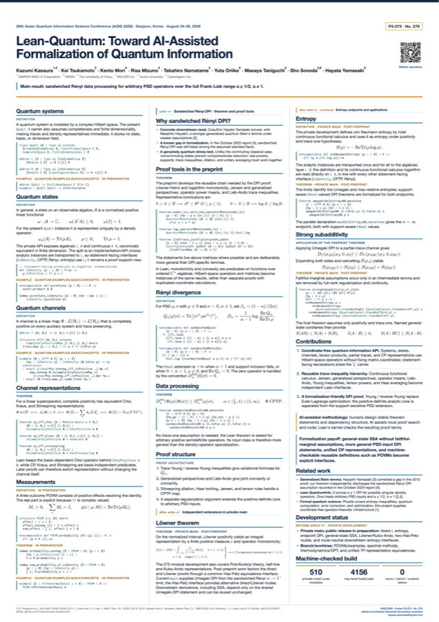

<p align="right"><a href="README.md"></a> </p>

# lean-quantum

量子情報理論と量子計算の Lean による形式化です．

> **IBIS 2026 でポスターをご覧になった方へ**：ポスターで紹介した形式化（Löwner と Hiai–Petz の定理から一般化量子Steinの補題へ）のコードは，ブランチ [`paper2`](https://github.com/Hayata-Yamasaki-Group/lean-quantum/tree/paper2) にあります．

<!-- BEGIN BADGES -->
<p align="center">
<a href="https://lean-lang.org/"></a>
<a href="https://arxiv.org/abs/2607.05492"></a>
<a href="LICENSE"></a>
</p>
<!-- END BADGES -->

## 更新情報

- **2026 年 10 月**：Lean-Quantum の第 2 の論文（Paper 2，投稿準備中）で報告する形式化を，ブランチ [`paper2`](https://github.com/Hayata-Yamasaki-Group/lean-quantum/tree/paper2) で公開しました．
- **2026 年 10 月**：arXiv:2607.05492 の第 2 版（投稿予定）に合わせてコードを更新しました．標準の数学ライブラリである Mathlib の考え方（[Mathlib's values](https://leanprover-community.github.io/contribute/values.html)）を取り入れ，たとえば大きなファイルを，主題ごとの小さなファイルに分け，Lean の宣言（定義や定理）の名前を，一部を除いて [Mathlib の命名規則](https://leanprover-community.github.io/contribute/naming.html)にそろえました．また，いくつかの定義と定理を述べ直しました．[結果](#結果)に挙げた 34 個の定理は，Comparator で独立に検査できるようにしました．arXiv v1 に対応するコードは，コミット [`bf1c4f6`](https://github.com/Hayata-Yamasaki-Group/lean-quantum/tree/bf1c4f6aaec84948f1a1c76c0728432813404a0f) で引き続き参照できます．

## 目次

- [対象範囲](#対象範囲)
- [線形作用素と有界線形作用素](#線形作用素と有界線形作用素)
- [実行方法](#実行方法)
- [独立な証明の検査](#独立な証明の検査)
- [結果](#結果)
- [ポスター発表（AQIS 2026）](#ポスター発表aqis-2026)
- [引用方法](#引用方法)

## 対象範囲

このライブラリは現在，有限次元の量子情報理論を中心に（一部の作用素不等式は無限次元も含めて），その基礎を，Lean の証明検査器（kernel．Lean の中で証明を検査する小さな中核部分）が検査した形で提供しています．主な内容は次のとおりです：

- 量子系，量子状態，完全正・トレース保存（CPTP）写像
- テンソル積の空間の上の部分トレース，Choi 作用素，Kraus 表現，Stinespring 表現
- 作用素単調性と作用素凸性，Löwner–Heinz の定理，Jensen の作用素不等式，一般化されたパースペクティブ，作用素幾何平均，Hilbert–Schmidt 作用素空間，Lieb–Ando トレース不等式
- サンドイッチ Rényi 相対エントロピーとそのデータ処理不等式（DPI），あわせてその非負性と，Umegaki 相対エントロピーおよび最大相対エントロピーへの極限
- von Neumann エントロピー，Umegaki 相対エントロピーの DPI，強劣加法性（SSA）
- 補助的な結果として，連続関数計算の補題（テンソル積の冪，冪の指数による微分など），トレースの Young の不等式，ユニタリ群上の Haar 測度による平均

[`Quantum.lean`](Quantum.lean) は，[`Quantum/`](Quantum/) フォルダにあるすべてのモジュール（Lean のファイル）を読み込みます．`import Quantum` と書けば，このライブラリのすべての公開の宣言を使えます．

## 線形作用素と有界線形作用素

有限次元の Hilbert 空間では線形作用素はすべて有界なので，線形作用素の空間 $\mathcal L(\mathcal H)$ と有界線形作用素の空間 $\mathcal B(\mathcal H)$ は同一視できます．ただし Lean では，両者は別の型（`ℋ →ₗ[ℂ] ℋ` と `ℋ →L[ℂ] ℋ`）です．Mathlib は $\mathcal B(\mathcal H)$ を C*-環として扱い，連続関数計算 `cfc`（作用素の冪や対数を定義するのに使う）やユニタリ群上の Haar 測度はその上で使えます．このリポジトリは $\mathcal L(\mathcal H)$ にも $\mathcal B(\mathcal H)$ から写した C*-環の構造を入れ，証明では必要なところで作用素を $\mathcal B(\mathcal H)$ の型に移して使います（Hilbert–Schmidt 内積も $\mathcal B(\mathcal H)$ の型の上に作りました）．`cfc` は，定義上，前提を満たさない元（実関数では自己共役でない元）には値 $0$ を返します．このため，[定理で使う定義](#定理で使う定義)の表には，意図した入力の外での値も書きました．主な有限次元の定理（完全正値性，Lieb–Ando，エントロピーと DPI など）は $\mathcal L(\mathcal H)$ の型で，作用素の冪の定理は一般の C*-環で，Jensen の作用素不等式と一般化されたパースペクティブの定理は，無限次元も含む Hilbert 空間の $\mathcal B(\mathcal H)$ の型で述べています．

## 実行方法

手元でコンパイルして検査する手順です（README を読むだけなら不要です）．Lean（elan）が入っていなければ，先に [`elan` で Lean をインストールします](https://lean-lang.org/install/)．

```bash
git clone https://github.com/Hayata-Yamasaki-Group/lean-quantum.git
cd lean-quantum
lake exe cache get   # Mathlib のビルド済みファイルを取る
lake build           # すべての証明を Lean の証明検査器で検査する
```

- Lean のバージョンと依存関係は [lean-toolchain](lean-toolchain) と [lake-manifest.json](lake-manifest.json) で固定され，数学ライブラリとして依存するのは Mathlib だけです（Comparator は検証のための道具です）．
- `lake update` は実行しないでください（固定した依存関係のバージョンが変わります）．
- `lake build` は `sorry` があっても警告を出すだけで成功します．ライブラリと解答のファイルに `sorry` はありません（ステートメントだけのファイルには，証明を省いた印として意図的に置いています）．各定理が使う公理は，`#print axioms` に定理の名前を付けて確かめられます（`sorry` を使っていれば `sorryAx` が表示されます）．

## 独立な証明の検査

**保証**：[Comparator](https://github.com/leanprover/comparator) は，コードベース全体を信用しなくても，ステートメントだけのファイル [`Paper1.lean`](ComparatorChallenges/Paper1.lean)（Comparator の用語では challenge）とそれが読み込むモジュール，検査の設定（[`Paper1.json`](ComparatorChallenges/Paper1.json)），およびビルドの設定（lakefile）を信用すれば，検査が成功したとき，`Paper1.lean` に書いた 34 個の定理（[結果](#結果)に挙げたもの）が証明されていると言えるようにする検査です（その他の前提は [Comparator の README](https://github.com/leanprover/comparator/blob/a4f696825c583ed8a5b4060d9a0faa5b882d365b/README.md) をご覧ください）．

**検査の手順**：証明を持つ解答のファイル [`Paper1Solution.lean`](ComparatorChallenges/Paper1Solution.lean)（Comparator の用語では solution）を，書き込める場所を制限したサンドボックス（landrun）の中でビルドし，各定理が `Paper1.lean` と同じステートメント（ステートメントに使う定義も含めて）であること，Lean の標準の 3 公理（`propext`，`Classical.choice`，`Quot.sound`）だけを使っていること（`sorry` を使う証明はここで不合格になります）を確かめ，証明を Lean の証明検査器（kernel）と，それとは独立に作られた証明検査器 nanoda の両方で検査し直します．

**信用するもの**：読み込むモジュールについて信用するのは，そこで定義された語の意味（[定理で使う定義](#定理で使う定義)の表で確かめます）と，ビルドのときに検査の対象や検査の処理を書き換えるプログラムを含まないこと（Lean のファイルはビルド中にプログラムを実行できます）だけで十分です．34 個の定理が依存する証明は，それらのモジュールの中にあっても Comparator が検査し直すからです．

**実行の結果**：この版は，Landlock が有効な Linux の上で，解答のファイルを隔離した環境でビルドして Comparator を実行し，34 個の定理すべてが Lean の証明検査器と nanoda の両方で受理されました．

**確かめられないこと**：Lean の定理のステートメント（暗黙の引数や型クラスのインスタンスを含む）とそこで使う定義が，論文で意図された通りの主張を表しているかは，Comparator では確かめられないので，ユーザーが読んで確かめる必要があります．そのために，以下では[定理で使う定義](#定理で使う定義)の一覧を表にまとめています．準備と実行の手順は [ComparatorChallenges/README.md](ComparatorChallenges/README.md) にあります（隔離して実行するには，Landlock が有効な Linux が要ります）．

## 結果

34 個の定理（ライブラリのすべての定理ではなく，Comparator の検査の対象として選んだもの）を，次の 1〜6 節の表で示します．

1. [完全正値性とチャネルの表現](#1-完全正値性とチャネルの表現)（6 件）
2. [作用素単調・作用素凸な冪関数](#2-作用素単調作用素凸な冪関数)（5 件）
3. [Jensen の作用素不等式と一般化されたパースペクティブ](#3-jensen-の作用素不等式と一般化されたパースペクティブ)（6 件）
4. [Lieb–Ando トレース不等式](#4-liebando-トレース不等式)（3 件）
5. [サンドイッチ Rényi 相対エントロピーのデータ処理不等式とその帰結](#5-サンドイッチ-rényi-相対エントロピーのデータ処理不等式とその帰結)（9 件）
6. [診断の結果](#6-診断の結果)（5 件）
- [定理で使う定義](#定理で使う定義)

以下の 1〜6 節の表は，次の 3 つの列からなります．

- **論文の箇所**
  - 1〜5 節では，我々の論文（[arXiv:2607.05492](https://arxiv.org/abs/2607.05492)）がその定理に言及している式の番号か地の文へのリンク（論文に掲載した Lean のコードではない）
  - 6 節では，作用素凸性などの述語を論文が導入する節へのリンク
  - 地の文は，各表の前に最初と最後の語を「…」でつないで引用
  - 第 2 版の公開までは arXiv v1 の節・式の番号・文で示し，リンクも arXiv v1 を指す（公開後に差し替える予定）
- **主張**
  - 1〜5 節では，論文の第 2 版（投稿予定）が取り上げた数学の定理（その多くは原典があり，証明も含めて形式化の元になっている）
  - Lean で述べるために原典や論文から仮定や範囲を変えたところは，各表のこの列と各節の本文に書く
- **Lean の宣言**
  - その定理を Lean で形式化したもの
  - リンクはステートメントだけのファイル [`Paper1.lean`](ComparatorChallenges/Paper1.lean) の宣言を開く
  - 証明は [`Paper1Solution.lean`](ComparatorChallenges/Paper1Solution.lean) の同じ名前の定理からたどれる

ユーザーは，「主張」と「Lean の宣言」のステートメントを見比べ，そのステートメントがこのリポジトリの定義を使っている場合は[定理で使う定義](#定理で使う定義)の表もあわせて見ます．ユーザーが確かめるのは，ステートメント（暗黙の引数や型クラスのインスタンスを含む）が意図どおりの形式化になっているかどうかで，それが証明されていることは Comparator が確かめる，という分担です（Comparator を信用するための前提は[独立な証明の検査](#独立な証明の検査)にあります）．

34 個の定理のうち 29 個は，論文の 1.5 節と 2–4 節で述べた定理のいくつかを形式化したもので，一つの定理を Lean では複数の定理に分けたものもあります．残りの 5 個は，我々が作用素凸性・作用素凹性を自己共役な元に限って定義した根拠を示すもので（[6. 診断の結果](#6-診断の結果)），論文の定理ではありません．各節では，初めにその節の定理の一つを例として掲げ，その節に共通する仮定を述べたあと，表にその節の定理を挙げます．以下では，作用素（2 節では C*-環の元）が半正定値であることを PSD，半正定値かつ可逆であることを PD と書きます．

### 1. 完全正値性とチャネルの表現

CP は Mathlib の意味の完全正値性である（[定理で使う定義](#定理で使う定義)の `IsCompletelyPositive`）．入力の空間 $\mathcal H_1$ の基底 $b=(b_i)$ を一つ選び（正規直交でなくてもよい）， $\mathrm{vec}_b(I)=\sum_ib_i\otimes b_i$ とおくと，Choi 作用素 $C_\Phi$ による特徴付け（Choi の定理）は次のとおりである：

$$\mathrm{CP}(\Phi) \iff C_\Phi\ge0,\qquad C_\Phi:=(\Phi\otimes\mathrm{id})[\mathrm{vec}_b(I)\mathrm{vec}_b(I)^\dagger].$$

この節の定理は，有限次元の複素 Hilbert 空間 $\mathcal H_1,\mathcal H_2$ の作用素の空間の間の複素線形写像 $\Phi:L(\mathcal H_1)\to L(\mathcal H_2)$ （超作用素とも呼ぶ）について述べる．論文は，次の 6 つの同値を 2.2 節の 1 つの段落でまとめて述べている．

「論文の箇所」列の文：

- [2.2 節](https://arxiv.org/html/2607.05492v1#S2.SS2.p13)：“The main equivalence theorem relates … rank Stinespring representations.”

| 論文の箇所 | 主張 | Lean の宣言 |
|---|---|---|
| [2.2 節](https://arxiv.org/html/2607.05492v1#S2.SS2.p13) | $\mathrm{CP}(\Phi)$ は， $\Phi\otimes\mathrm{id}_{L(\mathcal H_1)}$ が正であることと同値である． | [`cp_iff_tensor`](ComparatorChallenges/Paper1.lean#L62) |
| [上⁠に⁠同⁠じ](https://arxiv.org/html/2607.05492v1#S2.SS2.p13) | $\mathrm{CP}(\Phi)$ は，Choi 作用素が $C_\Phi\ge0$ を満たすことと同値である． | [`cp_iff_choi`](ComparatorChallenges/Paper1.lean#L71) |
| [上⁠に⁠同⁠じ](https://arxiv.org/html/2607.05492v1#S2.SS2.p13) | $\mathrm{CP}(\Phi)$ は，有限の $J$ について $\Phi(X)=\sum_{a\in J}A_aXA_a^\dagger$ と書けることと同値である． | [`cp_iff_kraus`](ComparatorChallenges/Paper1.lean#L83) |
| [上⁠に⁠同⁠じ](https://arxiv.org/html/2607.05492v1#S2.SS2.p13) | $\mathrm{CP}(\Phi)$ は， $\lvert J\rvert=\mathrm{rank}C_\Phi$ を満たす Kraus 表現をもつことと同値である． | [`cp_iff_rank_kraus`](ComparatorChallenges/Paper1.lean#L91) |
| [上⁠に⁠同⁠じ](https://arxiv.org/html/2607.05492v1#S2.SS2.p13) | $\mathrm{CP}(\Phi)$ は，有限次元の $E$ について $\Phi(X)=\mathrm{Tr}_E[AXA^\dagger]$ と書けることと同値である． | [`cp_iff_stinespring`](ComparatorChallenges/Paper1.lean#L103) |
| [上⁠に⁠同⁠じ](https://arxiv.org/html/2607.05492v1#S2.SS2.p13) | $\mathrm{CP}(\Phi)$ は， $\dim E=\mathrm{rank}C_\Phi$ を満たす Stinespring 表現をもつことと同値である． | [`cp_iff_rank_stinespring`](ComparatorChallenges/Paper1.lean#L119) |

### 2. 作用素単調・作用素凸な冪関数

順序付き複素 C*-環の元 $A,B$ と実数 $p$ について，Löwner–Heinz の不等式は次のとおりである：

$$0\le p\le1, 0\le B\le A \implies B^p\le A^p.$$

この節の定理は，順序付き複素 C*-環の元について述べ，実数冪は連続関数計算で定める（非負の冪は PSD の元，負の冪は PD の元に対して考える）．

「論文の箇所」列の文：

- [3.1 節（正⁠の⁠冪）](https://arxiv.org/html/2607.05492v1#S3.SS1.p8)：“These express the standard facts that … for $1\le p\le2$.”
- [3.1 節（負⁠の⁠冪）](https://arxiv.org/html/2607.05492v1#S3.SS1.p9)：“The current Core interface also includes negative-power results, … trace inequalities:”

| 論文の箇所 | 主張 | Lean の宣言 |
|---|---|---|
| [3.1 節（正⁠の⁠冪）](https://arxiv.org/html/2607.05492v1#S3.SS1.p8) | $0\le p\le1$ について， $x\mapsto x^p$ は $[0,\infty)$ 上で作用素単調である． | [`power_Icc_zero_one_operatorMonotoneOn_Ici`](ComparatorChallenges/Paper1.lean#L138) |
| [上⁠に⁠同⁠じ](https://arxiv.org/html/2607.05492v1#S3.SS1.p8) | $0\le p\le1$ について， $x\mapsto x^p$ は $[0,\infty)$ 上で作用素凹である． | [`operatorConcaveOn_rpow_Ici`](ComparatorChallenges/Paper1.lean#L146) |
| [上⁠に⁠同⁠じ](https://arxiv.org/html/2607.05492v1#S3.SS1.p8) | $1\le p\le2$ について， $x\mapsto x^p$ は $[0,\infty)$ 上で作用素凸である． | [`operatorConvexOn_rpow_Ici`](ComparatorChallenges/Paper1.lean#L155) |
| [3.1 節（負⁠の⁠冪）](https://arxiv.org/html/2607.05492v1#S3.SS1.p9) | $-1\le p\le0$ について， $x\mapsto-x^p$ は $(0,\infty)$ 上で作用素単調である． | [`power_Icc_neg_one_zero_neg_operatorMonotoneOn_Ioi`](ComparatorChallenges/Paper1.lean#L164) |
| [上⁠に⁠同⁠じ](https://arxiv.org/html/2607.05492v1#S3.SS1.p9) | $-1\le p\le0$ について， $x\mapsto-x^p$ は $(0,\infty)$ 上で作用素凹である． | [`operatorConcaveOn_neg_rpow_Ioi`](ComparatorChallenges/Paper1.lean#L173) |

### 3. Jensen の作用素不等式と一般化されたパースペクティブ

有限個の作用素についての Jensen の作用素不等式は次のとおりである：複素 Hilbert 空間 $\mathcal H$ の上の有界作用素 $A_j,X_j\in\mathcal B(\mathcal H)$ （ $j$ は有限個の添字）で， $A_j$ が PSD， $\sum_jX_j^\dagger X_j\le I$ を満たすものと， $[0,\infty)$ 上で一様に作用素凸（すべての複素 Hilbert 空間で作用素凸）かつ連続で $f(0)\le0$ を満たす実関数 $f$ について，

$$f[\sum_jX_j^\dagger A_jX_j]\le\sum_jX_j^\dagger f[A_j]X_j.$$

この節の定理は，有限次元を仮定しない複素 Hilbert 空間で述べる．

「論文の箇所」列の文：

- [3.4 節](https://arxiv.org/html/2607.05492v1#S3.SS4.p2)：“The main theorem packages the implication … two-operator Jensen form:”
- [3.5 節（凸⁠性）](https://arxiv.org/html/2607.05492v1#S3.SS5.p5)：“Thus, if $f$ is operator convex … positive-definite domains.”
- [3.5 節（凹⁠性）](https://arxiv.org/html/2607.05492v1#S3.SS5.p7)：“The corresponding concavity theorem is obtained … to $-f$:”

| 論文の箇所 | 主張 | Lean の宣言 |
|---|---|---|
| [3.4 節](https://arxiv.org/html/2607.05492v1#S3.SS4.p2) | 列作用素が縮小作用素となる（ $X^\dagger X+Y^\dagger Y\le I$ ）とき，PSD の入力について 2 作用素の Jensen の不等式が成り立つ． | [`jensenColumn_of_opConvexIciAll`](ComparatorChallenges/Paper1.lean#L182) |
| [3.5 節（凸⁠性）](https://arxiv.org/html/2607.05492v1#S3.SS5.p5) | PSD の $A$ と PD の $B$ について，一般化されたパースペクティブ $(f\Delta h)(A,B)$ は同時凸である． $f$ は $[0,\infty)$ 上で一様に作用素凸かつ連続で $f(0)\le0$ ， $h$ は $(0,\infty)$ 上で作用素凹かつ連続で正． | [`jointlyConvexOn_generalizedPerspective_psdSet_pdSet`](ComparatorChallenges/Paper1.lean#L191) |
| [3.5 節（凹⁠性）](https://arxiv.org/html/2607.05492v1#S3.SS5.p7) | PSD の $A$ と PD の $B$ について，一般化されたパースペクティブ $(f\Delta h)(A,B)$ は同時凹である． $f$ は $[0,\infty)$ 上で一様に作用素凹かつ連続で $f(0)\ge0$ ， $h$ は凸性の行と同じ． | [`jointlyConcaveOn_generalizedPerspective_psdSet_pdSet`](ComparatorChallenges/Paper1.lean#L206) |
| [3.4 節，式 (30)](https://arxiv.org/html/2607.05492v1#S3.E30) | $[0,\infty)$ 上で一様に作用素凸かつ連続で $f(0)\le0$ を満たす $f$ について，有限の Jensen の不等式が成り立つ． | [`jensenFinite_of_opConvexIciAll`](ComparatorChallenges/Paper1.lean#L413) |
| [上⁠に⁠同⁠じ](https://arxiv.org/html/2607.05492v1#S3.E30) | 原点を含む開区間 $I$ 上で一様に作用素凸で $f(0)\le0$ を満たす $f$ と，スペクトルが $I$ に含まれる自己共役な $A_j$ （PSD でなくてよい）について，有限の Jensen の不等式が成り立つ． | [`jensenFinite_of_opConvexOnAll_of_isOpen`](ComparatorChallenges/Paper1.lean#L457) |
| [上⁠に⁠同⁠じ](https://arxiv.org/html/2607.05492v1#S3.E30) | 原点を含む区間 $I$ 上で一様に作用素凸で， $f(0)\le0$ を満たし， $I$ に含まれる端点で $I$ 内から連続な $f$ と，スペクトルが $I$ に含まれる自己共役な $A_j$ について，有限の Jensen の不等式が成り立つ． | [`jensenFinite_of_opConvexOnAll_of_endpoints`](ComparatorChallenges/Paper1.lean#L473) |

### 4. Lieb–Ando トレース不等式

有限次元の複素 Hilbert 空間 $\mathcal H$ の作用素 $A,B,K\in L(\mathcal H)$ で $A,B$ が PD のものと， $0<s<1$ について，次の実数値の Lieb 汎関数は同時凹である（Lieb の凹性定⁠理）：

$$(A,B)\mapsto\mathrm{Re}\mathrm{Tr}[A^sK^\dagger B^{1-s}K].$$

この節の定理は，有限次元の複素 Hilbert 空間で述べる．

| 論文の箇所 | 主張 | Lean の宣言 |
|---|---|---|
| [3.7 節，式 (39)](https://arxiv.org/html/2607.05492v1#S3.E39) | Lieb 汎関数は $0<s<1$ について同時凹である． | [`jointlyConcaveOn_liebTraceMap_pdSetLM`](ComparatorChallenges/Paper1.lean#L223) |
| [上⁠に⁠同⁠じ](https://arxiv.org/html/2607.05492v1#S3.E39) | Lieb 汎関数は $1\le s\le2$ について同時凸である． | [`jointlyConvexOn_liebTraceMap_pdSetLM`](ComparatorChallenges/Paper1.lean#L233) |
| [3.7 節，式 (40)](https://arxiv.org/html/2607.05492v1#S3.E40) | $1\le q\le2$ ， $0\le r\le1$ ， $1\le q-r$ について， $\mathrm{Re}\mathrm{Tr}[A^qK^\dagger B^{-r}K]$ は同時凸である． | [`jointlyConvexOn_andoTraceMap_pdSetLM`](ComparatorChallenges/Paper1.lean#L243) |

### 5. サンドイッチ Rényi 相対エントロピーのデータ処理不等式とその帰結

定理 1 は，サンドイッチ Rényi 相対エントロピーのデータ処理不等式（DPI）である： $\mathcal H_1$ 上の密度作用素 $\rho,\sigma$ （ $\sigma$ は PD），CPTP 写像 $\Phi:L(\mathcal H_1)\to L(\mathcal H_2)$ ， $\alpha\in[1/2,1)\cup(1,\infty)$ について，

$$D_\alpha(\Phi[\rho]\Vert\Phi[\sigma])\le D_\alpha(\rho\Vert\sigma).$$

3 者の強劣加法性（SSA）の 2 行は， $\tau_C=I_C/\dim C$ として $D_\alpha(\rho_{BC}\Vert\rho_B\otimes\tau_C)\le D_\alpha(\rho_{ABC}\Vert\rho_{AB}\otimes\tau_C)$ を述べる．この節の定理は有限次元の複素 Hilbert 空間で述べる．DPI の写像はすべて CPTP とし，DPI と Rényi の SSA では上に示した $\alpha$ の範囲を使う．ダイバージェンスは実数値で，`NN` の付く版だけは PSD の入力に対する拡張実数値の版である（定理 1 は `NN` の版で述べる）．

「論文の箇所」列の文：

- [4.4 節](https://arxiv.org/html/2607.05492v1#S4.SS4.p3)：“The development also formalizes … DPI for positive semidefinite operators.”
- [1.5 節](https://arxiv.org/html/2607.05492v1#S1.SS5.p1)：“In the limit $\alpha\to1$, the sandwiched Rényi … Umegaki relative entropy”

| 論文の箇所 | 主張 | Lean の宣言 |
|---|---|---|
| [4.4 節](https://arxiv.org/html/2607.05492v1#Thmtheorem1) | 入力と出力が PD のとき，実数値の DPI が成り立つ（定理 1 の証明の核）． | [`sandwichedRenyiDiv_monotone`](ComparatorChallenges/Paper1.lean#L257) |
| [4.4 節](https://arxiv.org/html/2607.05492v1#S4.SS4.p3) | 任意の PSD の入力について，拡張実数値の DPI が成り立つ． | [`sandwichedRenyiDivNN_monotone`](ComparatorChallenges/Paper1.lean#L272) |
| [4.4 節，式 (65)，定⁠理 1](https://arxiv.org/html/2607.05492v1#S4.E65) | $\sigma$ が正定値である密度作用素の入力について，DPI が成り立つ（定理 1）． | [`sandwichedRenyiDivNN_monotone_of_isDensity`](ComparatorChallenges/Paper1.lean#L430) |
| [1.5 節，式 (4)](https://arxiv.org/html/2607.05492v1#S1.E4) | 状態について $S(\rho_{ABC})+S(\rho_B)$ $\le S(\rho_{AB})+S(\rho_{BC})$ が成り立つ． | [`strongSubadditivity_of_state`](ComparatorChallenges/Paper1.lean#L287) |
| [1.5 節](https://arxiv.org/html/2607.05492v1#S1.SS5.p1) | PD の入力について， $\alpha\to1^+$ のとき，サンドイッチ Rényi 相対エントロピーは，Umegaki 相対エントロピーを $\rho$ のトレースで割った値に収束する． | [`tendsto_sandwichedRenyiDiv_umegakiNorm_right`](ComparatorChallenges/Paper1.lean#L305) |
| [上⁠に⁠同⁠じ](https://arxiv.org/html/2607.05492v1#S1.SS5.p1) | PD の入力について， $\alpha\to1$ ， $\alpha\ne1$ のとき，サンドイッチ Rényi 相対エントロピーは，Umegaki 相対エントロピーを $\rho$ のトレースで割った値に収束する． | [`tendsto_sandwichedRenyiDiv_umegakiNorm_of_pd`](ComparatorChallenges/Paper1.lean#L317) |
| [1.5 節，式 (3)](https://arxiv.org/html/2607.05492v1#S1.E3) | 任意の PSD の入力について，拡張実数値の 3 者の SSA が成り立つ． | [`sandwichedRenyiDivNN_tripartiteSSA`](ComparatorChallenges/Paper1.lean#L328) |
| [上⁠に⁠同⁠じ](https://arxiv.org/html/2607.05492v1#S1.E3) | $\rho_{AB}\otimes\tau_C$ が PD で，両辺の $\mathrm{Re}\,Q_\alpha$ と $\mathrm{Re}\,\mathrm{Tr}\rho$ が 0 でないとき，実数値の 3 者の SSA が成り立つ． | [`sandwichedRenyiDiv_tripartiteSSA`](ComparatorChallenges/Paper1.lean#L343) |
| [1.5 節](https://arxiv.org/html/2607.05492v1#S1.SS5.p1) | $\rho\ne0$ かつ $\mathrm{supp}\rho\subseteq\mathrm{supp}\sigma$ を満たす PSD の入力について， $\alpha\to1$ ， $\alpha\ne1$ のとき，サンドイッチ Rényi 相対エントロピーは，Umegaki 相対エントロピーを $\rho$ のトレースで割った値に収束する． | [`tendsto_sandwichedRenyiDiv_umegakiNorm_of_supportLE`](ComparatorChallenges/Paper1.lean#L445) |

### 6. 診断の結果

この節の 5 個の定理は，我々が作用素凸性・作用素凹性を自己共役な元に限って定義した根拠を示すもので，論文が主張する定理ではない．[`OperatorConvex`](#def-operatorconvex) と [`OperatorConcave`](#def-operatorconcave) は，複素 C*-環の，自己共役でない元も含むすべての元の上で量化された述語で，[`OperatorConvexAll`](#def-operatorconvexall) と [`OperatorConcaveAll`](#def-operatorconcaveall) は，それを零でない完備な複素 Hilbert 空間のすべてで課す述語である．`cfc` は，定義上，自己共役でない元には値 $0$ を返すので，これらを満たすのは（C*-環が非自明なら）$f=0$ だけである：

$$\mathrm{OperatorConvexAll}(f) \implies f=0.$$

このため，これらの述語を定理の仮定に置くと，$f\ne0$ では仮定が成り立たず，定理は空虚に成り立つだけになる．そこで Jensen の作用素不等式と一般化されたパースペクティブの定理では，自己共役でスペクトルが区間 $s$ に含まれる元に限って量化する述語（`OperatorConvexOn` など）を使う．たとえば $s=[0,\infty)$ （PSD の元）に限った作用素凸性は $x\mapsto x^2$ を許す．以下の「論文の箇所」は，作用素凸性などの述語を論文が導入する 3.1 節を指す．

| 論文の箇所 | 主張 | Lean の宣言 |
|---|---|---|
| [3.1 節](https://arxiv.org/html/2607.05492v1#S3.SS1) | `OperatorConvex` は，すべての実数 $x$ について $f(x)=0$ を強いる． | [`OperatorConvex.eq_zero_of_nontrivial`](ComparatorChallenges/Paper1.lean#L367) |
| [上⁠に⁠同⁠じ](https://arxiv.org/html/2607.05492v1#S3.SS1) | `OperatorConcave` は，すべての実数 $x$ について $f(x)=0$ を強いる． | [`OperatorConcave.eq_zero_of_nontrivial`](ComparatorChallenges/Paper1.lean#L378) |
| [上⁠に⁠同⁠じ](https://arxiv.org/html/2607.05492v1#S3.SS1) | `OperatorConvexAll` は $f=0$ を強いる． | [`OperatorConvexAll.eq_zero`](ComparatorChallenges/Paper1.lean#L388) |
| [上⁠に⁠同⁠じ](https://arxiv.org/html/2607.05492v1#S3.SS1) | `OperatorConcaveAll` は $f=0$ を強いる． | [`OperatorConcaveAll.eq_zero`](ComparatorChallenges/Paper1.lean#L396) |
| [上⁠に⁠同⁠じ](https://arxiv.org/html/2607.05492v1#S3.SS1) | $x\mapsto x^2$ は $[0,\infty)$ 上で一様に作用素凸である． | [`operatorConvexOnAll_Ici_sq`](ComparatorChallenges/Paper1.lean#L404) |

### 定理で使う定義

下の表は，[`Paper1.lean`](ComparatorChallenges/Paper1.lean) の 34 個の定理のステートメントに現れる定義を，[結果](#結果)の各節で触れた順に説明します．Mathlib の定義は載せていません．各項目は，Lean の定義が述べていることを，想定する入力の外での値も含めて書きます．

| Lean&nbsp;の&#8288;定&#8288;義 | 定義の内容 |
|---|---|
| **共通** | |
| [`Qudit`](Quantum/QuantumMechanics/QuantumState.lean#L20) | 有限次元の複素内積空間（ノルム付きで完備）の型クラス．次元 $0$ も許し，非零は別の仮定 `Nontrivial` |
| [`L`](Quantum/QuantumMechanics/OperatorNotation.lean#L26) | 複素線形写像 `ℋ →ₗ[ℂ] ℋ` の型 `L ℋ`．順序は Mathlib の Löwner 順序（ $X\le Y$ は $Y-X$ が半正定値であること） |
| [`B`](Quantum/QuantumMechanics/OperatorNotation.lean#L29) | 有界（連続）な複素線形作用素 `ℋ →L[ℂ] ℋ` の型 `B ℋ`．順序は Löwner 順序 |
| [`Tr`](Quantum/QuantumMechanics/QuantumState.lean#L39) | `L ℋ` 上のトレース `LinearMap.trace ℂ ℋ` ．値は複素数 |
| [`T`](Quantum/QuantumMechanics/Channel/Basic.lean#L31) | 複素線形写像 `L ℋ₁ →ₗ[ℂ] L ℋ₂` の型 `T ℋ₁ ℋ₂`．正値性やトレースの条件は含まない |
| **1. 完全正値性とチャネルの表現** | |
| [`IsCompletelyPositive`](Quantum/QuantumMechanics/Channel/AmplificationCore.lean#L111) | Mathlib の意味（`CompletelyPositiveMap`）で完全正：任意の $k$ について， $\Phi$ を成分ごとに作用させると，C*-環 `L ℋ₁` を成分とする $k\times k$ の正の行列が正の行列に移る |
| [`AmplificationPositive`](Quantum/QuantumMechanics/Channel/TensorModel.lean#L282) | $L(\mathcal H_1\otimes\mathcal H_1)$ から $L(\mathcal H_2\otimes\mathcal H_1)$ への $\Phi\otimes\mathrm{id}_{L(\mathcal H_1)}$ が半正定値作用素を半正定値作用素に移す |
| [`ChoiPositive`](Quantum/QuantumMechanics/Channel/Representations.lean#L36) | $\mathcal H_1$ の基底 $b$ （正規直交とは限らない）について， $\Omega_b=\sum_ib_i\otimes b_i=\mathrm{vec}_b(I)$ とおくと $L(\mathcal H_2\otimes\mathcal H_1)$ で $(\Phi\otimes\mathrm{id})(\lvert\Omega_b\rangle\langle\Omega_b\rvert)\ge0$ |
| [`HasKraus`](Quantum/QuantumMechanics/Channel/Representations.lean#L68) | 有限の添字型 $\kappa$ （空でもよく， $\mathcal H_1$ と同じ宇宙）と線形写像 $A_a:\mathcal H_1\to\mathcal H_2$ があって，すべての $X$ で $\Phi(X)=\sum_{a\in\kappa}A_aXA_a^\dagger$ |
| [`HasRankKraus`](Quantum/QuantumMechanics/Channel/Representations.lean#L72) | `HasKraus` で，さらに $\lvert\kappa\rvert$ が `choiRank b Φ` （下）に等しい |
| [`traceOutRight`](Quantum/QuantumMechanics/Channel/Representations.lean#L232) | 右の因子についての部分トレース．線形写像 $L(\mathcal H_2\otimes\mathcal H_3)\to L(\mathcal H_2)$ で $X\otimes Y\mapsto\mathrm{Tr}(Y)X$ （因子を入れ替えてから下の `traceOutLeft` を適用して定義） |
| [`choiRank`](Quantum/QuantumMechanics/Channel/Representations.lean#L60) | `ChoiPositive` の Choi 作用素 $(\Phi\otimes\mathrm{id})(\lvert\Omega_b\rangle\langle\Omega_b\rvert)$ の階数（値域の次元）．値は自然数 |
| **2. 作用素単調・作用素凸な冪関数** | |
| [`OperatorMonotoneOn`](Quantum/TraceInequality/LownerHeinz/Defs.lean#L79) | 固定した順序付きの C*-環で，スペクトルが $s$ に含まれる自己共役な $A,B$ が $B\le A$ なら $f(B)\le f(A)$ ．ここで $f(A)$ は Mathlib の連続関数計算 `cfc f A` |
| [`LownerHeinzCore.OperatorConcaveOn`](Quantum/TraceInequality/LownerHeinz/Defs.lean#L241) | 同じ環での `OperatorConvexOn s (-f)` （下） |
| [`OperatorConvexOn`](Quantum/TraceInequality/LownerHeinz/Defs.lean#L191) | 固定した順序付きの C*-環で，スペクトルが $s$ に含まれる自己共役な $A,B$ と $t\in[0,1]$ について $f((1-t)A+tB)\le(1-t)f(A)+tf(B)$ （`cfc`）． $(1-t)A+tB$ のスペクトルには別の条件を課さない |
| **3. Jensen の作用素不等式と一般化されたパースペクティブ** | |
| [`OperatorConvexIciAllContNonposAtZero`](Quantum/TraceInequality/JensenOperatorInequalityIImpIV.lean#L75) | `OperatorConvexOnAll (Set.Ici 0) f` （下）， $[0,\infty)$ 上での $f$ の連続性， $f(0)\le0$ の三つ |
| [`JensenContractiveColumnCondition`](Quantum/TraceInequality/JensenOperatorInequalityIImpIV.lean#L84) | 固定した Hilbert 空間で，スペクトルが $[0,\infty)$ に含まれる自己共役な $A,B$ （`B ℋ` の元）と $X^\dagger X+Y^\dagger Y\le I$ を満たす $X,Y$ について $f(X^\dagger AX+Y^\dagger BY)\le X^\dagger f(A)X+Y^\dagger f(B)Y$ （下の `cfcR`） |
| [`LownerHeinzTheorem.OperatorConcaveOn`](Quantum/TraceInequality/LownerHeinzTheorem.lean#L91) | 与えられた Hilbert 空間 $\mathcal H$ の C*-環 `B ℋ` での `LownerHeinzCore.OperatorConcaveOn s f` |
| [`JointlyConvexOn`](Quantum/TraceInequality/GeneralizedPerspectiveFunction.lean#L32) | $A_1,A_2\in s$ ， $B_1,B_2\in t$ ， $\theta\in[0,1]$ について， $A_\theta=(1-\theta)A_1+\theta A_2$ ， $B_\theta=(1-\theta)B_1+\theta B_2$ とおくと $\Phi(A_\theta,B_\theta)$ は $(1-\theta)\Phi(A_1,B_1)+\theta\Phi(A_2,B_2)$ 以下． $s,t$ の凸性は要求しない |
| [`psdSet`](Quantum/TraceInequality/GeneralizedPerspectiveFunction.lean#L97) | `B ℋ` の元のうち，自己共役でスペクトルが $[0,\infty)$ に含まれるものの集合 |
| [`pdSet`](Quantum/TraceInequality/GeneralizedPerspectiveFunction.lean#L101) | `B ℋ` の元のうち，自己共役でスペクトルが $(0,\infty)$ に含まれるもの（半正定値かつ可逆）の集合 |
| [`generalizedPerspective`](Quantum/TraceInequality/GeneralizedPerspectiveFunction.lean#L81) | $h(B)^{1/2}f(h(B)^{-1/2}Ah(B)^{-1/2})h(B)^{1/2}$ ．ここで $h(B)^{\pm1/2}$ は `cfcR (fun x ↦ h x ^ (±1/2)) B` （`cfcR` は下）．すべての $A,B$ で定義し， $h(B)$ の正値性と可逆性は定理の側で仮定する |
| [`OperatorConcaveOnAll`](Quantum/TraceInequality/LownerHeinzTheorem.lean#L204) | 宇宙 `u` のすべての零でない完備な複素 Hilbert 空間 $K$ （次元は任意）での `LownerHeinzTheorem.OperatorConcaveOn s f` |
| [`JointlyConcaveOn`](Quantum/TraceInequality/GeneralizedPerspectiveFunction.lean#L44) | `JointlyConvexOn` の不等式を逆向きにしたもの |
| [`cfcR`](Quantum/TraceInequality/LownerHeinzTheorem.lean#L37) | `B ℋ` の元 $A$ に対する Mathlib の `cfc f A` （実連続関数計算による $f(A)$ ）． $A$ が自己共役でないか， $f$ が $A$ のスペクトル上で連続でなければ $0$ |
| [`OperatorConvexOnAll`](Quantum/TraceInequality/LownerHeinzTheorem.lean#L169) | 宇宙 `u` のすべての零でない完備な複素 Hilbert 空間 $K$ （次元は任意）で，`B K` における `LownerHeinzCore.OperatorConvexOn s f` |
| **4. Lieb–Ando トレース不等式** | |
| [`pdSetLM`](Quantum/QuantumEntropy/Common/PositiveDefiniteSet.lean#L47) | `L ℋ` の元のうち，有界作用素とみなすと `pdSet` に入るものの集合（自己共役でスペクトルが $(0,\infty)$ に含まれる，すなわち正定値） |
| [`liebTraceMap`](Quantum/TraceInequality/LiebAndo/TraceMapLM.lean#L21) | `liebTraceMap s K A B` $=\mathrm{Re}\,\mathrm{Tr}[A^sK^\dagger B^{1-s}K]\in\mathbb R$ ．冪は Mathlib の `CFC.rpow` （半正定値でない引数では $0$ ） |
| [`andoTraceMap`](Quantum/TraceInequality/LiebAndo/TraceMapLM.lean#L26) | `andoTraceMap q r K A B` $=\mathrm{Re}\,\mathrm{Tr}[A^qK^\dagger B^{-r}K]\in\mathbb R$ ．冪は同じく `CFC.rpow` |
| **5. サンドイッチ Rényi 相対エントロピーのデータ処理不等式とその帰結** | |
| [`CPTP`](Quantum/QuantumMechanics/Channel/Basic.lean#L40) | 構造体．Mathlib の完全正写像 `CompletelyPositiveMap` で `L ℋ₁ → L ℋ₂` のもののうち，すべての $\rho$ で $\mathrm{Tr}\,\Phi(\rho)=\mathrm{Tr}\,\rho$ を満たすもの．写像は `Φ.toFun` |
| [`sandwichedRenyiDiv`](Quantum/QuantumEntropy/SandwichedRenyi/DefinitionCore.lean#L79) | 実数値の $\frac{1}{\alpha-1}\log\frac{\mathrm{Re}\,Q_\alpha(\rho\Vert\sigma)}{\mathrm{Re}\,\mathrm{Tr}\rho}$ （ $Q_\alpha$ は下の `sandwichedQuasi`）．Lean の `Real.log` では $\log0=0$ で，サポートの条件は課さない． $\alpha=1$ での値は $0$ |
| [`sandwichedRenyiDivNN`](Quantum/QuantumEntropy/SandwichedRenyi/NonNeg/Defs.lean#L43) | 拡張実数値． $\alpha>1$ で `SupportLE ρ σ` （下）が成り立たないとき，または $\alpha<1$ ， $\rho\ne0$ ， $\mathrm{Re}\,Q_\alpha(\rho\Vert\sigma)=0$ のときは $+\infty$ ．それ以外は `sandwichedRenyiDiv α ρ σ` ．特に $D_\alpha(0\Vert\sigma)=0$ |
| [`IsDensity`](Quantum/QuantumMechanics/QuantumState.lean#L59) | $X$ が半正定値（`IsPositive`）で $\mathrm{Tr}X=1$ |
| [`IsPositiveDefinite`](Quantum/QuantumMechanics/QuantumState.lean#L51) | $X$ が半正定値で $\det X\ne0$ |
| [`vonNeumannEntropy`](Quantum/QuantumEntropy/VonNeumann/Basic.lean#L115) | $S(\rho)=-\mathrm{Re}\,\mathrm{Tr}[\rho\log\rho]\in\mathbb R$ ． $\log$ は Mathlib の `CFC.log` （`cfc Real.log` なので核の上では $\log0=0$ ）．すべての作用素で定義 |
| [`traceOutLeft`](Quantum/QuantumMechanics/Channel/Basic.lean#L89) | 左の因子についての部分トレース．線形写像 $L(\mathcal H_1\otimes\mathcal H_2)\to L(\mathcal H_2)$ で $X\otimes Y\mapsto\mathrm{Tr}(X)Y$ |
| [`traceOutThird`](Quantum/QuantumEntropy/VonNeumann/PartialTraceThirdCPTP.lean#L96) | $L(\mathcal H_1\otimes(\mathcal H_2\otimes\mathcal H_3))$ から $L(\mathcal H_1\otimes\mathcal H_2)$ への写像．結合の同型で組み替えてから `traceOutRight` を適用する（ $\rho_{ABC}\mapsto\rho_{AB}$ ） |
| [`umegakiNorm`](Quantum/QuantumEntropy/UmegakiDPI/AlphaOneCore.lean#L30) | $\mathrm{Re}\,\mathrm{Tr}[\rho(\log\rho-\log\sigma)]$ を $\mathrm{Re}\,\mathrm{Tr}\,\rho$ で割った実数値（`CFC.log`）．サポートの条件は課さない |
| [`tripartiteReference`](ComparatorChallenges/Paper1.lean#L42) | `tripartiteReference X Y` は $L((A\otimes B)\otimes C)$ の $X\otimes Y$ を，結合の同型で $L(A\otimes(B\otimes C))$ に移したもの |
| [`sandwichedQuasi`](Quantum/QuantumEntropy/SandwichedRenyi/DefinitionCore.lean#L33) | $Q_\alpha(\rho\Vert\sigma)=\mathrm{Tr}[(\sigma^{\gamma}\rho\sigma^{\gamma})^{\alpha}]\in\mathbb C$ ， $\gamma=(1-\alpha)/(2\alpha)$ ．冪は `CFC.rpow` （半正定値な $\sigma$ の負の冪はサポートの上でとり，核の上では $0$ ） |
| [`SupportLE`](Quantum/QuantumEntropy/Common/Support.lean#L26) | $\ker\sigma\subseteq\ker\rho$ （自己共役な $\rho,\sigma$ では $\mathrm{supp}\rho\subseteq\mathrm{supp}\sigma$ と同じ） |
| **6. 診断の結果** | |
| <a id="def-operatorconvex"></a>[`OperatorConvex`](Quantum/TraceInequality/LownerHeinz/Defs.lean#L159) | 固定した順序付きの C*-環のすべての元 $A,B$ （自己共役とは限らない）と $t\in[0,1]$ について $f((1-t)A+tB)\le(1-t)f(A)+tf(B)$ （`cfc` は自己共役でない元で $0$ ） |
| <a id="def-operatorconcave"></a>[`OperatorConcave`](Quantum/TraceInequality/LownerHeinz/Defs.lean#L218) | `OperatorConvex (-f)` |
| <a id="def-operatorconvexall"></a>[`OperatorConvexAll`](Quantum/TraceInequality/LownerHeinzTheorem.lean#L152) | 宇宙 `u` のすべての零でない完備な複素 Hilbert 空間 $K$ で，`B K` における `OperatorConvex f` |
| <a id="def-operatorconcaveall"></a>[`OperatorConcaveAll`](Quantum/TraceInequality/LownerHeinzTheorem.lean#L187) | 宇宙 `u` のすべての零でない完備な複素 Hilbert 空間 $K$ で，`B K` における `OperatorConcave f` |

## ポスター発表（AQIS 2026）

サムネイルをクリックすると，AQIS 2026 で発表したポスターを表示します．

このポスターは発表したときのまま保存しており，当時の我々の開発ブランチ（非公開）の計画，例，ビルドの統計を含みます．このリポジトリで扱う範囲は[対象範囲](#対象範囲)を見てください．

<p align="center">
  <a href="poster/aqis2026.pdf">
    
  </a>
</p>

## 引用方法

このライブラリを使う場合は，対応する[論文](https://arxiv.org/abs/2607.05492)を引用してください：

```bibtex
@article{kasaura2026leanquantum,
  title         = {Lean-Quantum: Toward AI-Assisted Formalization of Quantum Information},
  author        = {Kasaura, Kazumi and Tsukamoto, Kei and Mori, Kento and
                   Mizuno, Lisa and Namatame, Takahiro and Oriike, Yuta and
                   Taniguchi, Masaya and Sonoda, Sho and Yamasaki, Hayata},
  year          = {2026},
  eprint        = {2607.05492},
  archivePrefix = {arXiv},
  primaryClass  = {quant-ph},
  doi           = {10.48550/arXiv.2607.05492}
}
```
