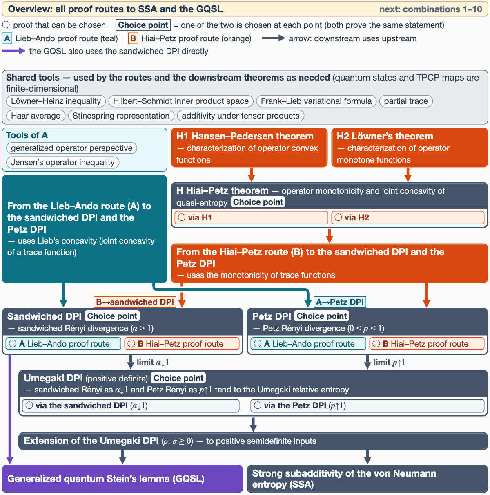
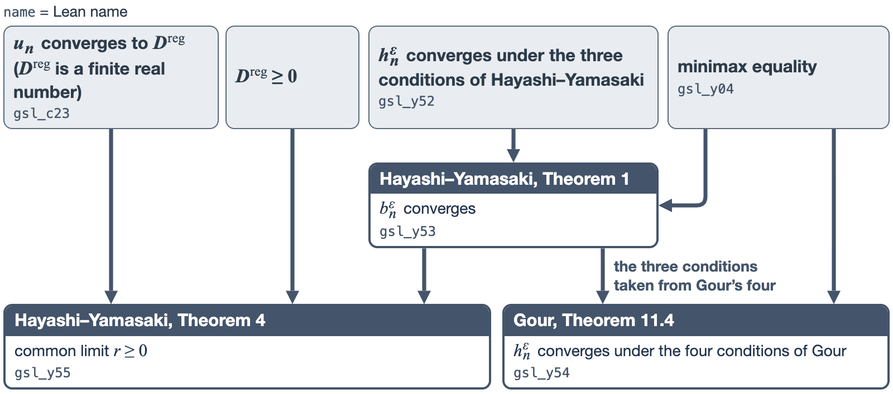

<p align="right"> <a href="README.ja.md"></a></p>

# Lean-Quantum: AI-assisted Lean formalization of quantum information<br><sub>From the theorems of Löwner and Hiai–Petz to the generalized quantum Stein's lemma</sub>

This is a library of quantum information theory written in the proof assistant Lean. It formalizes the theorems of Löwner and Hiai–&#8288;Petz and proves from them three data-processing inequalities (DPI), those of the sandwiched Rényi divergence, the Petz Rényi divergence and the Umegaki relative entropy, $D(\Phi\rho\Vert\Phi\sigma)\leq D(\rho\Vert\sigma)$ for every completely positive trace-preserving (TPCP) map $\Phi$. The DPIs also have proofs through the Lieb–&#8288;Ando trace inequalities, and the strong subadditivity (SSA) and the generalized quantum Stein's lemma follow from either proof.

This repository contains the formalization reported in the second Lean-Quantum paper (Paper 2), which is in preparation for submission.

<!-- BEGIN BADGES -->
<p align="center">
<a href="https://lean-lang.org/"></a>
<a href="LICENSE"></a>
</p>
<!-- END BADGES -->

Authors: Kazumi Kasaura, Kei Tsukamoto, Kento Mori, Lisa Mizuno, Takahiro Namatame, Yuta Oriike, Masaya Taniguchi, Sho Sonoda, and Hayata Yamasaki.

The DPIs are proved along several proof routes (chains of proofs leading to the same theorem). Whichever route is used, the statements of SSA and the GQSL and their proof code stay the same. The animation below first shows all the proof routes and then, one by one, the 10 combinations of proofs used in proving SSA and the GQSL.

<p align="center"></p>

## Contents

- [Background and scope of the formalization](#background-and-scope-of-the-formalization)
- [How to run](#how-to-run)
- [Main theorems formalized in this code](#main-theorems-formalized-in-this-code)
- [Checking with Comparator](#checking-with-comparator)
- [Prior work](#prior-work)
- [Poster presentation (IBIS 2026)](#poster-presentation-ibis-2026)
- [How to cite](#how-to-cite)

## Background and scope of the formalization

The generalized quantum Stein's lemma (GQSL) is a result in quantum resource theory: it gives the optimal error exponent of a test that distinguishes many copies of a quantum state from free states (the states regarded as available at no cost). <a id="what-is-covered"></a>

The lemma was formulated and proved by [Brandão–&#8288;Plenio (2010)](https://doi.org/10.1007/s00220-010-1005-z), but the proof contained a gap that went unnoticed for more than 10 years ([Berta et al. 2023](https://doi.org/10.22331/q-2023-09-07-1103)); correct proofs were later given ([Hayashi–&#8288;Yamasaki 2025](https://arxiv.org/abs/2408.02722); [Lami 2025](https://doi.org/10.1109/TIT.2025.3543610)). This repository formalizes the GQSL along the proof of Hayashi–&#8288;Yamasaki. An earlier Lean formalization follows the same proof; the differences are described in [Prior work](#prior-work).

Here, formalization means writing definitions, theorems and proofs as code in a proof assistant such as Lean and having its proof checker (the kernel) check every step of the proofs. A theorem that has passed the check can be used as a part of the next proof without worrying about errors in its proof; one only needs to check what its definitions and statement say. Proofs written by AI can be checked in the same way, so such a formalized library is a foundation for quantum information theory in an era when AI can generate proofs.

The main results formalized in this repository are the following two formulas. The hypotheses and symbols are detailed in [Main theorems](#main-theorems-formalized-in-this-code).

### Generalized quantum Stein's lemma

$$\Large\displaystyle\lim_{n\to\infty}\frac{1}{n}D_{\min}^{\varepsilon}(\rho^{\otimes n}\Vert F_n)=D^{\mathrm{reg}}(\rho\Vert F)\qquad(0<\varepsilon<1)$$

Here $\rho$ is a state, $F_n$ is the set of free states on $n$ copies, $D_{\min}^{\varepsilon}$ is the hypothesis-testing relative entropy and $D^{\mathrm{reg}}$ is the regularized relative entropy. The left-hand side is the optimal exponent of the type-II error when the type-I error is kept at most $\varepsilon$, with each free state tested separately, which is the form of Gour. Its agreement with the form of Hayashi–&#8288;Yamasaki, a single test against all of $F_n$, is in [6. Generalized quantum Stein's lemma](#6-generalized-quantum-steins-lemma).

### Strong subadditivity of the von Neumann entropy

$$\Large\displaystyle S(\rho_{ABC})+S(\rho_B)\leq S(\rho_{AB})+S(\rho_{BC})$$

Here $\rho_{ABC}$ is a state of three systems and $S$ is the von Neumann entropy.

We call the DPIs of the sandwiched Rényi divergence ($\alpha>1$), of the Petz Rényi divergence ($0\lt p\lt 1$) and of the Umegaki relative entropy the sandwiched DPI, the Petz DPI and the Umegaki DPI. The formalization in brief:

- Formalized in [our first paper](#how-to-cite) ([Kasaura et al. 2026](https://arxiv.org/abs/2607.05492)): the shared tools; the sandwiched DPI through the Lieb–&#8288;Ando trace inequalities; the Umegaki DPI obtained from it as a limit, and SSA.
- Newly formalized in this repository: Löwner's theorem; the Hiai–&#8288;Petz theorem with its two proofs, from the Hansen–&#8288;Pedersen theorem and from Löwner's theorem; the Hansen–&#8288;Pedersen theorem; the sandwiched DPI and the Petz DPI through the Hiai–&#8288;Petz theorem; the Petz DPI through the Lieb–&#8288;Ando trace inequalities; SSA derived also from the Petz DPI; the GQSL derived from the DPIs.
- Definitions and spaces: quantum states and TPCP maps (quantum channels) are finite-dimensional and are defined with linear spaces and linear operators that do not depend on a choice of basis. The DPIs are stated for positive semidefinite operators, and the Hiai–&#8288;Petz theorem for matrices. One of the four conditions of Löwner's theorem is stated in arbitrary C*-algebras, and the Hansen–&#8288;Pedersen theorem for operators on arbitrary complex Hilbert spaces.
- Proof checking: all proofs, including both proofs of each DPI and of the Hiai–&#8288;Petz theorem, are checked by Lean's kernel. Only the 3 standard axioms of Lean are used ([Checking with Comparator](#checking-with-comparator)).
- Where AI was used: AI agents (Claude Code of Anthropic and Codex of OpenAI, mainly with the Opus and Fable models of Claude and the GPT models of OpenAI) wrote the Lean proofs; people chose the targets and decided on the statements of the theorems and the acceptance of the proofs. The correctness of the proofs is checked not by AI but by Lean's kernel.

## How to run

These steps compile and check the code on your own computer; they are not needed for reading this README.

```bash
git clone -b paper2 https://github.com/Hayata-Yamasaki-Group/lean-quantum.git
cd lean-quantum
lake exe cache get   # download the prebuilt files of Mathlib
lake build           # check every proof with Lean's kernel
```

- If Lean is not installed, first [install it with `elan`](https://lean-lang.org/install/). The Lean version and the dependencies are fixed by [lean-toolchain](lean-toolchain) and [lake-manifest.json](lake-manifest.json); the only direct dependency is Mathlib.
- Do not run `lake update` (it would change the pinned versions of the dependencies).
- Lean normally warns about `sorry`; a successful `lake build` alone does not prove its absence. The proofs of the library contain no `sorry` (it appears only in the statement files and in the two deliberately invalid inputs for the axiom check, [Paper2SolutionAxiom.lean](ComparatorChallenges/Paper2SolutionAxiom.lean) and [GslSolutionAxiom.lean](ComparatorChallenges/GslSolutionAxiom.lean)). The axioms a theorem depends on can be checked with `#print axioms` followed by its name (a proof using `sorry` shows `sorryAx`).

## Main theorems formalized in this code

The sections below give the main theorems of this repository in tables, from operator inequalities to SSA and the GQSL.

1. [Löwner's theorem](#1-löwners-theorem) (3 theorems)
2. [Hiai–&#8288;Petz theorem](#2-hiaipetz-theorem) (2)
3. [Sandwiched DPI and Petz DPI](#3-sandwiched-dpi-and-petz-dpi) (DPIs used in the proofs of 4–6)
4. [Umegaki DPI](#4-umegaki-dpi) (2)
5. [Strong subadditivity (SSA)](#5-strong-subadditivity-ssa) (1)
6. [Generalized quantum Stein's lemma](#6-generalized-quantum-steins-lemma) (3)

The tables have three columns: Reference, Statement and Lean. The Reference column gives where the theorem comes from: the numbered theorem of the source literature (some rows point to a passage of our first paper). The Statement column restates the theorem of the Reference column; where hypotheses or the scope were changed to state it in Lean, this is written in the Statement column and in the text of each section. The Lean column gives the name of the declaration that states the theorem in Lean; clicking the name opens that declaration in [Paper2.lean](ComparatorChallenges/Paper2.lean), the file with only the statements checked with Comparator (with proofs left as `sorry`). The table of the Umegaki DPI has no Reference column, because its theorems are not given with a numbered theorem of the literature. The definitions used in the statements are listed [at the end of this section](#definitions-used-in-the-statements).

### 1. Löwner's theorem

Löwner's theorem characterizes operator monotone functions. One of the two proofs of the Hiai–&#8288;Petz theorem uses this theorem. <a id="h2-löwners-theorem--characterization-of-operator-monotone-functions"></a>

The theorem states that the following four conditions on the values of a real function $f$ on $(-1,1)$ are equivalent: (a) positive semidefinite Löwner matrices; (b) a Pick extension; (c) an integral representation by a finite measure $\nu$ on $[-1,1]$; (d) $f-f(0)$ operator monotone. The third row of the table below (Theorem 3.12 of Simon) is (c) $\Rightarrow$ (d): $f-f(0)$ is operator monotone for $f$ with the integral representation

$$f(x)=f(0)+\int_{[-1,1]}\frac{x}{1+tx}\thinspace d\nu(t)\qquad(-1\lt x\lt 1).$$

The operator monotonicity in (d) is taken in every C\*-algebra, not necessarily unital.

| Reference | Statement | Lean |
|---|---|---|
| [Simon&nbsp;(2019)](https://doi.org/10.1007/978-3-030-22422-6), Theorems&nbsp;1.3 and&nbsp;5.1, organized as four conditions | (a) $\Leftrightarrow$ (b) $\Leftrightarrow$ (c) $\Leftrightarrow$ (d). | [`loewner…⁠FourConditions`](ComparatorChallenges/Paper2.lean#L87 "loewnerUnitIntervalFourConditions") |
| [Simon&nbsp;(2019)](https://doi.org/10.1007/978-3-030-22422-6), Theorem&nbsp;3.8 | (b) $\Leftrightarrow$ (c). | [`…⁠PickExtension_iff_integralRep`](ComparatorChallenges/Paper2.lean#L93 "unitIntervalPickExtension_iff_integralRep") |
| [Simon&nbsp;(2019)](https://doi.org/10.1007/978-3-030-22422-6), Theorem&nbsp;3.12 | (c) $\Rightarrow$ (d). | [`…⁠_of_integralRep`](ComparatorChallenges/Paper2.lean#L98 "operatorMonotoneOnUnitInterval_of_integralRep") |

---

### 2. Hiai–Petz theorem

The Hiai–&#8288;Petz theorem relates operator monotonicity and the joint concavity of quasi-entropy. <a id="h-hiaipetz-theorem--operator-monotonicity-and-joint-concavity-of-quasi-entropy"></a>

The theorem states that, for a function $f>0$ continuous on $(0,\infty)$, the following conditions (i)–(iv) are equivalent. For positive definite matrices $A,B$ and a matrix $X$ we write ($S_f^X$ is the quasi-entropy)

$$L_AX:=AX,\quad R_BX:=XB,\quad J_f(A,B):=f(L_AR_{B^{-1}})\thinspace R_B,\quad S_f^X(A,B):=\mathrm{Re}\thinspace\mathrm{Tr}\bigl(X^{\ast}J_f(A,B)X\bigr).$$

(i) Operator monotonicity: for Hermitian matrices $A,B$ of every size,

$$0\lt A\leq B\space\Longrightarrow\space f(A)\leq f(B).$$

(ii) and (iii), two operator inequalities: (ii) is $\Phi^{\ast}J_f(\Phi A,\Phi B)^{-1}\Phi\leq J_f(A,B)^{-1}$ and (iii) is $\Phi J_f(A,B)\Phi^{\ast}\leq J_f(\Phi A,\Phi B)$. They are required for the positive, trace-preserving linear maps $\Phi$ whose adjoint is a Schwarz map (including the TPCP maps); $\Phi^{\ast}$ is the adjoint with respect to the Hilbert–&#8288;Schmidt inner product, and $\leq$ is the order of operators on the space of matrices.

(iv) Joint concavity of the quasi-entropy: for $0\leq t\leq1$, positive definite matrices $A_1,A_2,B_1,B_2$ and a matrix $X$,

$$tS_f^X(A_1,B_1)+(1-t)S_f^X(A_2,B_2)\leq S_f^X\bigl(tA_1+(1-t)A_2,\space tB_1+(1-t)B_2\bigr).$$

The library proves the two theorems below in two ways: through the Hansen–&#8288;Pedersen theorem (used by default) and through Löwner's theorem.

| Reference | Statement | Lean |
|---|---|---|
| [Hiai&nbsp;(2025)](https://saiensu.co.jp/search/?isbn=978-4-7819-1637-8&y=2025), Theorem&nbsp;6.2 | (i)–(iv) are equivalent, with (ii) and (iii) required for maps with $\Phi(I)>0$. | [`strictDPIEquivalences`](ComparatorChallenges/Paper2.lean#L57) |
| [Hiai&nbsp;(2025)](https://saiensu.co.jp/search/?isbn=978-4-7819-1637-8&y=2025), Theorem&nbsp;6.2 (output-support form) | (i)–(iv) are equivalent in the output-support form: (ii) and (iii) are required after compressing the map to its output support, without $\Phi(I)>0$. | [`outputSupportDPIEquivalences`](ComparatorChallenges/Paper2.lean#L60) |

---

### 3. Sandwiched DPI and Petz DPI

The DPIs of the sandwiched and the Petz Rényi divergences given in this section are building blocks of the proofs of the Umegaki DPI, SSA and the GQSL below; their statements are collected in `RenyiDPI.SandwichedSide` and `RenyiDPI.PetzSide` in the [table of definitions](#definitions-used-in-the-statements). Each is proved in two ways, through the Lieb–&#8288;Ando trace inequalities and through the Hiai–&#8288;Petz theorem. They are not among the 19 theorems checked with [Comparator](#checking-with-comparator); Lean's kernel checks their proofs when the library is built. <a id="sandwiched-dpi-and-petz-dpi--data-processing-inequalities-for-rényi-divergences"></a>

The sandwiched Rényi divergence for $\alpha>1$ and the Petz Rényi divergence for $0\lt p\lt 1$ are, with the natural logarithm,

$$\tilde D_\alpha(\rho\Vert\sigma):=\frac{1}{\alpha-1}\log\frac{\mathrm{Tr}\bigl[(\sigma^{\frac{1-\alpha}{2\alpha}}\rho\sigma^{\frac{1-\alpha}{2\alpha}})^{\alpha}\bigr]}{\mathrm{Tr}(\rho)},\qquad D_p(\rho\Vert\sigma):=\frac{1}{p-1}\log\frac{\mathrm{Tr}(\rho^{p}\sigma^{1-p})}{\mathrm{Tr}(\rho)}.$$

Their values are in the extended reals; they are 0 for $\rho=0$ and may be $+\infty$ depending on the supports. The conventions are in the [sandwiched](Quantum/QuantumEntropy/SandwichedRenyiBase/NonNeg/Defs.lean#L42 "SandwichedRenyiRelativeEntropy.sandwichedRenyiDivNN") and [Petz](Quantum/QuantumEntropy/RenyiDPI/Defs.lean#L48 "RenyiDPI.petzDivNN") definitions. Both proofs prove the same three statements: the DPI for every TPCP map $\Phi$ and all $\rho,\sigma\geq0$; additivity under tensor products for density operators; and, for positive definite inputs, the limit as the Rényi parameter tends to 1 is the Umegaki relative entropy.

---

### 4. Umegaki DPI

The theorems of this section are the data-processing inequality for the Umegaki relative entropy. <a id="umegaki-dpi--data-processing-for-the-umegaki-relative-entropy"></a>

They concern the DPI, for a TPCP map $\Phi$, of the Umegaki relative entropy divided by the trace, $D(\rho\Vert\sigma):=\mathrm{Re}\thinspace\mathrm{Tr}(\rho(\log\rho-\log\sigma))/\mathrm{Re}\thinspace\mathrm{Tr}(\rho)$ (natural logarithm). The first row of the table below is the data-processing inequality of this $D$ for positive definite $\rho$, $\sigma$, $\Phi\rho$, $\Phi\sigma$:

$$D(\Phi\rho\Vert\Phi\sigma)\leq D(\rho\Vert\sigma).$$

Both theorems are classical results. The first row is proved by default as the limit of the sandwiched DPI (it can also be obtained as the limit of the Petz DPI); the second row extends it to positive semidefinite inputs (the extension of the Umegaki DPI).

| Statement | Lean |
|---|---|
| $D(\Phi\rho\Vert\Phi\sigma)\leq D(\rho\Vert\sigma)$ when $\rho$, $\sigma$, $\Phi\rho$, $\Phi\sigma$ are positive definite. | [`monotoneOnPosDef`](ComparatorChallenges/Paper2.lean#L71) |
| $D(\Phi\rho\Vert\Phi\sigma)\leq D(\rho\Vert\sigma)$ in the extended reals for all $\rho,\sigma\geq0$, with no support inclusion assumed; $D=+\infty$ without it. | [`monotoneOnNonNeg`](ComparatorChallenges/Paper2.lean#L77) |

---

### 5. Strong subadditivity (SSA)

The theorem of this section is the strong subadditivity of the von Neumann entropy. <a id="strong-subadditivity-of-the-von-neumann-entropy-ssa"></a>

The theorem of the table below is the following inequality for a density operator $\rho_{ABC}$ of three systems:

$$S(\rho_{ABC})+S(\rho_B)\leq S(\rho_{AB})+S(\rho_{BC}).$$

Here $\rho_{AB},\rho_{BC},\rho_B$ are the marginals of $\rho_{ABC}$ taken by partial traces, and the systems $A,B,C$ are nonzero finite-dimensional complex Hilbert spaces.

| Reference | Statement | Lean |
|---|---|---|
| [Lieb–&#8288;Ruskai&nbsp;(1973)](https://doi.org/10.1063/1.1666274); [our first paper, Section&nbsp;1.5, Eq.&nbsp;(4)](https://arxiv.org/html/2607.05492v1#S1.E4) | The inequality above holds for every $\rho_{ABC}\geq0$ with $\mathrm{Tr}(\rho_{ABC})=1$ (the marginals need not be positive definite). | [`strongSubadditivity_of_state`](ComparatorChallenges/Paper2.lean#L44) |

---

### 6. Generalized quantum Stein's lemma

The three theorems of this section are the GQSL stated in two forms, Theorem 11.4 of Gour (a separate test for each free state) and Theorem 1 of Hayashi–&#8288;Yamasaki (one test for the whole set of free states), and Theorem 4 of Hayashi–&#8288;Yamasaki (the regularized relative entropy is a nonnegative real number, and the rates of the latter form and of the Umegaki relative entropy both converge to it). The proof follows Hayashi–&#8288;Yamasaki. <a id="generalized-quantum-steins-lemma--the-proof-follows-hayashiyamasaki"></a>

The first row of the table below (Theorem 11.4 of Gour) is the following formula, the same as in the [background](#generalized-quantum-steins-lemma):

$$\lim_{n\to\infty}\frac{1}{n}D_{\min}^{\varepsilon}(\rho^{\otimes n}\Vert F_n)=D^{\mathrm{reg}}(\rho\Vert F)\qquad(0<\varepsilon<1).$$

The symbols are those of the background. Of the rates (to base 2), the one on the left-hand side is $h_n^\varepsilon:=\frac{1}{n}\inf_{\sigma\in F_n}D_{\min}^{\varepsilon}(\rho^{\otimes n}\Vert\sigma)$ (the form of Gour) and $b_n^\varepsilon$ is the form of Hayashi–&#8288;Yamasaki, using one test for all of $F_n$. Further, $u_n:=\frac{1}{n}\inf_{\sigma\in F_n}D(\rho^{\otimes n}\Vert\sigma)$ and $D^{\mathrm{reg}}(\rho\Vert F):=\inf_{n\geq1}u_n$, where $D$ is the $D$ of the second row of [4. Umegaki DPI](#4-umegaki-dpi) to base 2. Here $\rho$ is a density operator on a nonzero finite-dimensional complex Hilbert space.

| Reference | Statement | Lean |
|---|---|---|
| [Gour&nbsp;(2024), Theorem&nbsp;11.4](https://arxiv.org/pdf/2402.05474v2#nameddest=theorem.11.4) | If $F$ satisfies the density-operator condition and the four conditions of Gour, then $h_n^\varepsilon\to D^{\mathrm{reg}}(\rho\Vert F)$ for every $\varepsilon\in(0,1)$. | [`gsl_y54`](ComparatorChallenges/Paper2.lean#L20) |
| [Hayashi–&#8288;Yamasaki&nbsp;(2025), Theorem&nbsp;1](https://arxiv.org/html/2408.02722v3#Thmtheorem1) | If $F$ satisfies the density-operator condition and the three conditions of Hayashi–&#8288;Yamasaki, then $b_n^\varepsilon\to D^{\mathrm{reg}}(\rho\Vert F)$ for every $\varepsilon\in(0,1)$; permutation invariance is not assumed. | [`gsl_y53`](ComparatorChallenges/Paper2.lean#L26) |
| [Hayashi–&#8288;Yamasaki&nbsp;(2025), Theorem&nbsp;4](https://arxiv.org/html/2408.02722v3#Thmtheorem4) | Under the density-operator condition and the three conditions of Hayashi–&#8288;Yamasaki, for every $\varepsilon\in(0,1)$ there is a real $r\geq0$ with $D^{\mathrm{reg}}(\rho\Vert F)=r$, $b_n^\varepsilon\to r$ and $u_n\to r$. | [`gsl_y55`](ComparatorChallenges/Paper2.lean#L32) |

**How the three theorems are related**

For a nonempty closed convex set of density operators, the [minimax equality](Quantum/QuantumEntropy/GourResource/Minimax.lean#L221 "GourResource.gsl_y04") (Hayashi–&#8288;Yamasaki, Lemma 3) gives $h_n^\varepsilon=b_n^\varepsilon$ for every $n\geq1$; with it, Gour's Theorem 11.4 is derived from Theorem 1 of Hayashi–&#8288;Yamasaki without the condition on permutations (figure below).

<p align="center"></p>

---

### Definitions used in the statements

The table lists the Lean definitions used in the statements of the tables above, with what each definition states.

| Lean&nbsp;definition | What the definition states |
|---|---|
| [`LoewnerPosOnUnitInterval`](Quantum/TraceInequality/Loewner/Statement.lean#L132) | (a): $f$ is differentiable on $(-1,1)$ and its Löwner matrices (diagonal $f'$) are positive semidefinite |
| [`PickExtensionOnUnitInterval`](Quantum/TraceInequality/Loewner/Statement.lean#L120) | (b): an analytic extension $F$ of $f$ across $(-1,1)$ mapping the upper half-plane into the closed upper half-plane |
| [`IntegralRepOnUnitInterval`](Quantum/TraceInequality/Loewner/Statement.lean#L77) | (c): the integral representation $f(x)=f(0)+\int_{[-1,1]}\frac{x}{1+tx}\thinspace d\nu(t)$ on $(-1,1)$ by a finite measure $\nu$ vanishing outside $[-1,1]$ |
| [`OperatorMonotoneOnUnitInterval`](Quantum/TraceInequality/Loewner/Statement.lean#L97) | (d): in every C\*-algebra, not necessarily unital, $f-f(0)$ is monotone on the self-adjoint elements with quasispectrum in $(-1,1)$ |
| [`StrictDPIEquivalences`](Quantum/TraceInequality/HiaiPetz/Interface/Strict.lean#L76) | the Hiai–&#8288;Petz theorem: for $f$ continuous and positive on $(0,\infty)$, (i)–(iv) of Section 2 are equivalent ((ii) and (iii) for maps with $\Phi(I)>0$) |
| [`OutputSupportDPIEquivalences`](Quantum/TraceInequality/HiaiPetz/Interface/OutputSupport.lean#L63) | the Hiai–&#8288;Petz theorem in the output-support form: for $f$ continuous and positive on $(0,\infty)$, (i)–(iv) of Section 2 are equivalent ((ii) and (iii) stated after compressing the map to its output support) |
| [`UmegakiDPI.MonotoneOnPosDef`](Quantum/QuantumEntropy/UmegakiDPI/Interface.lean#L21) | the Umegaki DPI: $D(\Phi\rho\Vert\Phi\sigma)\leq D(\rho\Vert\sigma)$ for a TPCP map $\Phi$ and positive definite $\rho,\sigma,\Phi\rho,\Phi\sigma$ ($D$ is the Umegaki relative entropy divided by the trace, of Section 4) |
| [`Qudit`](Quantum/QuantumMechanics/QuantumState.lean#L19) | the type class of finite-dimensional complex inner product spaces; nonzero is the separate hypothesis `Nontrivial` |
| [`CPTP`](Quantum/QuantumMechanics/Channel/Basic.lean#L35) | TPCP maps: the structure of completely positive, trace-preserving linear maps $L(\mathcal H_1)\to L(\mathcal H_2)$ |
| [`L`](Quantum/QuantumMechanics/QuantumState.lean#L27) | the type of linear operators (without a basis) |
| [`umegakiRelEntropyNN`](Quantum/QuantumEntropy/Common/Umegaki/GSLCoreUmegaki.lean#L30) | the $D$ of the extension of the Umegaki DPI: $+\infty$ without support inclusion, otherwise with $\log$ taken on the support, and $D(0\Vert\sigma):=0$ |
| [`RenyiDPI.SandwichedSide`](Quantum/QuantumEntropy/RenyiDPI/Interface.lean#L86) | the three statements that the two proofs of the sandwiched DPI prove: the DPI for $\alpha>1$ and $\rho,\sigma\geq0$; additivity under tensor products for density operators; and, for positive definite inputs, the limit as $\alpha\to1$ from above is the Umegaki relative entropy |
| [`RenyiDPI.PetzSide`](Quantum/QuantumEntropy/RenyiDPI/Interface.lean#L79) | the three statements that the two proofs of the Petz DPI prove: the DPI for $0\lt p\lt 1$ and $\rho,\sigma\geq0$; additivity under tensor products for density operators; and, for positive definite inputs, the limit as $p\to1$ from below is the Umegaki relative entropy |
| [`Tr`](Quantum/QuantumMechanics/QuantumState.lean#L48) | the trace (complex-valued) |
| [`VonNeumann.vonNeumannEntropy`](Quantum/QuantumEntropy/VonNeumann/Basic.lean#L121) | $S(\rho):=-\mathrm{Re}\thinspace\mathrm{Tr}(\rho\ln\rho)$ |
| [`QuantumChannel.traceOutRight`](Quantum/QuantumMechanics/Channel/Representations.lean#L227) | the partial trace over the right factor (from $\rho_{BC}$ to $\rho_B$) |
| [`QuantumChannel.traceOutLeft`](Quantum/QuantumMechanics/Channel/Basic.lean#L84) | the partial trace over the left factor (from $\rho_{ABC}$ to $\rho_{BC}$) |
| [`QuantumChannel.traceOutThird`](Quantum/QuantumEntropy/VonNeumann/PartialTraceThirdCPTP.lean#L96) | the partial trace over the third factor (from $\rho_{ABC}$ to $\rho_{AB}$) |
| [`State`](Quantum/QuantumEntropy/GourResource/Definitions.lean#L52) | the subtype of density operators |
| [`Family`](Quantum/QuantumEntropy/GourResource/Definitions.lean#L58) | a family $F$ of sets of free states |
| [`valid`](Quantum/QuantumEntropy/GourResource/Definitions.lean#L99) | the density-operator condition and the four conditions of Gour: closed and convex, closed under permutations, closed under tensor products, a positive definite element in $F_1$ (for $n\geq1$) |
| [`hRate`](Quantum/QuantumEntropy/GourResource/Definitions.lean#L146) | the rate $h_n^\varepsilon$ |
| [`reg`](Quantum/QuantumEntropy/GourResource/Definitions.lean#L159) | $D^{\mathrm{reg}}(\rho\Vert F):=\inf_{n\geq1}u_n$ |
| [`hyValid`](Quantum/QuantumEntropy/GourResource/Definitions.lean#L232) | the density-operator condition and the three conditions of Hayashi–&#8288;Yamasaki: closed and convex, closed under tensor products, a positive definite element in $F_1$ (closedness under permutations or partial traces not included) |
| [`rate`](Quantum/QuantumEntropy/GourResource/Definitions.lean#L141) | the rate $\frac{1}{n}a_n$ of a sequence $a$ |
| [`dSet`](Quantum/QuantumEntropy/GourResource/Definitions.lean#L257) | with one test for the whole of $F$, $-\log_2\inf_M\sup_{\sigma\in F}\mathrm{Re}\thinspace\mathrm{Tr}(\sigma M)$ over tests $M$ with type-I error at most $\varepsilon$ |
| [`pow`](Quantum/QuantumEntropy/GourResource/Definitions.lean#L61) | $\rho^{\otimes n}$ on the $n$-copy space |
| [`uRate`](Quantum/QuantumEntropy/GourResource/Definitions.lean#L151) | the rate $u_n$ (Umegaki relative entropy to base 2) |

## Checking with Comparator

[Comparator](https://github.com/leanprover/comparator) is a tool that compares the file with only the statements, [Paper2.lean](ComparatorChallenges/Paper2.lean), with the file with the proofs, [Paper2Solution.lean](ComparatorChallenges/Paper2Solution.lean). It confirms that each theorem has the same statement in both files, including the definitions used in the statement, and uses only Lean's 3 standard axioms (`propext`, `Quot.sound` and `Classical.choice`), and it checks the proofs again with two kernels: Lean's and nanoda, a proof checker developed independently of Lean. Paper2.lean has 19 theorems: the 11 theorems in the tables of [Main theorems](#main-theorems-formalized-in-this-code) and 8 theorems that give the Hiai–&#8288;Petz theorem with each of its two proofs and the Umegaki DPI as a limit of the sandwiched DPI and of the Petz DPI. <a id="proof-checking"></a>

Comparator's guarantee holds when its [stated assumptions](https://github.com/leanprover/comparator/blob/2312244ac716564a61cc0bf4e107d9abf1757a61/README.md) hold (among them, that the modules imported by the statement file and the Lake configuration are trusted, that the checking environment has not been tampered with, that the isolation works correctly, and that at least one of the two kernels is correct) and the check succeeds. Then what one needs to trust is the statements in Paper2.lean with the definitions they use, and the check settings in [ComparatorChallenges/Paper2.json](ComparatorChallenges/Paper2.json) (the theorem names, the permitted axioms and the use of nanoda).

In our run, all 19 passed on Linux (Ubuntu 24.04), with the solution builds run inside landrun; this run checks the known solutions of this repository and is not a guarantee of isolation for unknown solutions. The steps are in [ComparatorChallenges/README.md](ComparatorChallenges/README.md).

Comparator cannot check whether the statements and the definitions they use say what is intended; that is checked by people (so far only the authors).

<!-- gsl-summary -->
The library theorems of the three GQSL theorems are [`GourResource.gsl_y54`](Quantum/QuantumEntropy/GourResource/GeneralizedStein.lean#L141), [`GourResource.gsl_y53`](Quantum/QuantumEntropy/GourResource/GeneralizedStein.lean#L53) and [`GourResource.gsl_y55`](Quantum/QuantumEntropy/GourResource/GeneralizedStein.lean#L114). The two central ones (Gour's Theorem 11.4 and Theorem 1 of Hayashi–&#8288;Yamasaki) are also checked in a separate Comparator setup, [gsl.json](ComparatorChallenges/gsl.json), with the statements [`Gsl.y54`](ComparatorChallenges/GslChallenge.lean#L9) and [`Gsl.y53`](ComparatorChallenges/GslChallenge.lean#L15).

## Prior work

Before the formalization in this repository, Meiburg–&#8288;Lessa–&#8288;Soldati (2025, [arXiv:2510.08672](https://arxiv.org/abs/2510.08672)) formalized the GQSL in Lean along the same proof of Hayashi–&#8288;Yamasaki (their library, [Lean-QuantumInfo](https://github.com/Timeroot/Lean-QuantumInfo), is now part of [Physlib](https://reservoir.lean-lang.org/@leanprover-community/Physlib), the physics library of the Lean community). The DPI of the sandwiched Rényi divergence, used there as a known result, was at first left with `sorry` (the placeholder for an omitted proof), and was the last `sorry` remaining in the proof of the GQSL in Physlib. This unproved part was also filled before the formalization in this repository, when the Lean files of operator inequalities of Lean-Quantum from [our first paper](https://arxiv.org/abs/2607.05492), including Lieb's concavity used in the proof of that DPI, were [ported](https://github.com/leanprover-community/physlib/pull/1082) to Physlib, following, among other things, private communication with A. Meiburg. We regard this as an example showing that formalized code can be reused.

The proof of the GQSL in this repository also follows that of Hayashi–&#8288;Yamasaki (including the form of Theorem 11.4 of Gour). The DPIs that this proof uses (sandwiched, Petz and Umegaki) are proved in this repository from operator inequalities.

## Poster presentation (IBIS 2026)

The formalization in this repository will be presented at IBIS 2026 (the 29th Information-Based Induction Sciences Workshop), Poster Session 2, Wednesday, 28 October 2026, 14:30–17:30 JST, Sonic City, Saitama, Japan. Poster (in Japanese): [PDF](poster/paper2-poster-ja.pdf)

## How to cite

The Paper 2 manuscript is in preparation. Until it is available, please cite our first paper, [arXiv:2607.05492](https://arxiv.org/abs/2607.05492), which provides the shared tools:

```bibtex
@article{kasaura2026leanquantum,
  title         = {Lean-Quantum: Toward AI-Assisted Formalization of Quantum Information},
  author        = {Kasaura, Kazumi and Tsukamoto, Kei and Mori, Kento and
                   Mizuno, Lisa and Namatame, Takahiro and Oriike, Yuta and
                   Taniguchi, Masaya and Sonoda, Sho and Yamasaki, Hayata},
  year          = {2026},
  eprint        = {2607.05492},
  archivePrefix = {arXiv},
  primaryClass  = {quant-ph},
  doi           = {10.48550/arXiv.2607.05492}
}
```
